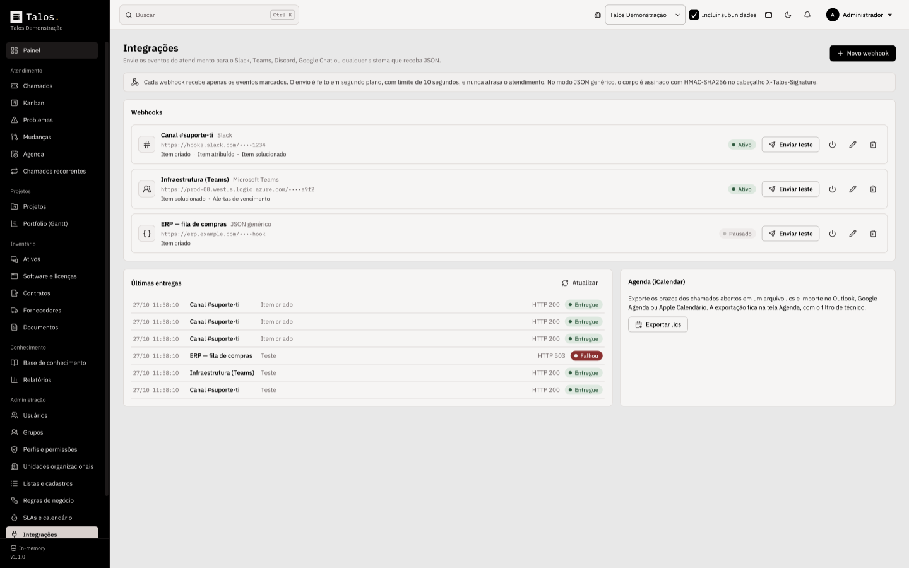
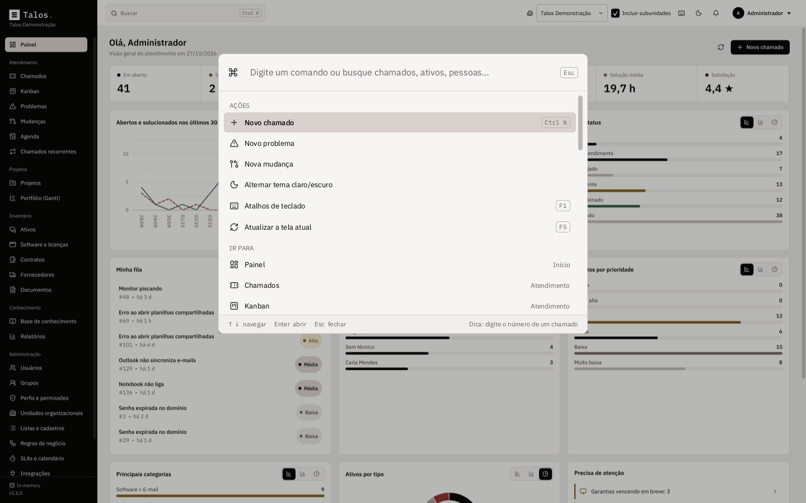

<p align="center">
  
</p>

<p align="center">
  <b>IT service management, help desk and asset inventory on your own computer.</b><br>
  A Windows desktop application inspired by the architecture of GLPI, built with Java, Spring Boot and JavaFX.
</p>

<p align="center">
  
  
  
  
  
  
</p>

<p align="center">
  <a href="../../raw/main/Talos-1.1.0.exe"><b>Download the installer</b></a> ·
  <a href="Manual-Talos-Vers%C3%A3o%201.1.0.pdf"><b>User manual (PDF, Portuguese)</b></a> ·
  <a href="CHANGELOG.md">Changelog</a> ·
  <a href="README.md">Leia em português</a>
</p>

---

<p align="center">
  
</p>

**Talos.** puts what an IT team uses every day into one program: tickets with SLA deadlines, ITIL problems and changes, a Kanban board, Gantt schedules, technician planning, an inventory of hardware, software and contracts, a knowledge base, reports and integrations with your team chat.

It runs on Windows like any other program: install it with a wizard and open it from the Start menu. There is no website and no web server. Your data lives in the database **you** choose, from a local H2 file to a PostgreSQL, MySQL, MariaDB, SQL Server or Oracle server shared by the team. The interface is available in Portuguese (Brazil) and English, with light and dark themes.

## Quick start

1. Download [**Talos-1.1.0.exe**](../../raw/main/Talos-1.1.0.exe) from the root of this repository, run it and finish the setup wizard.
2. Open **Talos** from the Start menu. On the welcome screen pick your language and a database: to try it out, choose **H2 (local file)**, which needs no server.
3. Create your organization and administrator account (there is no default password), sign in and finish the guided initial setup.
4. Press <kbd>Ctrl</kbd> + <kbd>N</kbd> to open your first ticket, or <kbd>Ctrl</kbd> + <kbd>K</kbd> to jump anywhere.

Just looking? Click **Explore without a database**: Talos. opens with sample data and nothing is saved.

<details>
<summary>Download and launch the installer from PowerShell</summary>

```powershell
$ProgressPreference='SilentlyContinue'; [Net.ServicePointManager]::SecurityProtocol='Tls12'; $f="$env:TEMP\Talos-1.1.0.exe"; Invoke-WebRequest 'https://github.com/ravelroot/Information-Technology-Service-Management/raw/main/Talos-1.1.0.exe' -OutFile $f -UseBasicParsing; Start-Process $f
```
</details>

> Windows SmartScreen may warn about an unknown publisher because the installer isn't code-signed: click **More info**, then **Run anyway**.

## What's new in 1.1.0

| | |
|---|---|
| **Integrations hub** | Webhooks for **Slack, Microsoft Teams, Discord, Google Chat** and **generic JSON** signed with HMAC-SHA256. Pick the events, send a test and review recent deliveries. |
| **iCalendar export** | Export the due dates of open tickets as `.ics` for Outlook, Google Calendar or Apple Calendar. |
| **Command palette** | <kbd>Ctrl</kbd> + <kbd>K</kbd> searches everything and runs actions: new ticket, go to any screen, switch theme. |
| **Shortcut guide** | <kbd>F1</kbd> lists every keyboard shortcut. |
| **Canned responses** | Standard replies in the ticket timeline, with the requester name and item number filled in. Managed under **Dropdown lists**. |

See the [CHANGELOG](CHANGELOG.md) for details. Installing 1.1.0 over 1.0.0 keeps your database, settings and saved connection; no new tables are created.

## Features

**Service desk (ITIL)**
- Incidents and requests with urgency, impact and a priority matrix, as in GLPI.
- Time-to-own and time-to-resolve SLAs per priority, counted in business hours with holidays and paused while a ticket is pending. Alerts when a deadline is at risk or breached.
- A timeline of follow-ups (public or private), tasks with time spent, solutions the requester accepts or refuses, and a satisfaction survey.
- Problems with symptoms, root cause and impact analysis; changes with rollout plan, backout plan, checklist, risk and an approval flow.
- A lean **new item** form one <kbd>Ctrl</kbd> + <kbd>N</kbd> away: title, board, type, category, assignees, followers and description. The full form is one click away.
- **One or more assignees** and **followers** per item, managed in the **People** tab or from the Kanban card menu.
- Ticket categories with colors and subcategories, links between items, affected assets and attached documents.
- Business rules that classify and route tickets when they open, with a built-in tester; recurring tickets and automatic closing of solved tickets.

**Kanban, Gantt and planning**
- Kanban boards for tickets, problems, changes and project tasks, with status colors, column counters (items, time worked, overdue), sorting and **Add ticket** per column.
- Project Gantt charts with dependencies, milestones, critical path and automatic rescheduling; a portfolio timeline of every active project.
- A weekly planning view of each technician's tasks, with **`.ics` export** of due dates to your calendar.

**Asset inventory**
- Computers, laptops, servers, monitors, printers, network devices, phones, tablets and peripherals, with asset tag, serial number, IP, MAC, warranty and owners.
- Network connections, installed software and license compliance; supplier contracts with notice periods and renewal; warranty and contract expiration alerts.
- CSV import and export, including a ready-made template.

**Knowledge base and self-service**
- Markdown articles with categories, drafts and an FAQ.
- A self-service interface where end users open and follow their own tickets.

**GLPI-style administration**
- Organization units in a hierarchy (GLPI "entities"), profiles with per-module rights granted per unit, groups, configurable dropdown lists, a full audit log and a trash bin.
- Reports with charts, notifications and **integrations** with Slack, Microsoft Teams, Discord, Google Chat and your own systems.

**Interface**
- Minimalist palette in grays, sand and black (`#E8E8E8`, `#D9D1CE`, `#BAB7B5`, `#AB9D9D`, `#000000`) in **light** and **dark** themes.
- Smooth motion: animated screen transitions, smooth scrolling, animated cards and indicators. The window opens maximized.
- **Command palette** (<kbd>Ctrl</kbd> + <kbd>K</kbd>) and **shortcut guide** (<kbd>F1</kbd>).
- **Zoom** from 50% to 175% (75% by default), smooth transitions and charts as bars, columns, line or donut.
- **Demo mode**: try every screen with sample data, no database needed.
- [**User manual (PDF, Portuguese)**](Manual-Talos-Vers%C3%A3o%201.1.0.pdf) covering every screen, feature, shortcut and technical detail.

## Screenshots

| | |
|---|---|
|  |  |
| Ticket timeline and properties | Kanban with status colors, assignees and due dates |
|  |  |
| Integrations with Slack, Teams, Discord and Google Chat | Command palette with search and actions |
|  |  |
| Gantt with dependencies and critical path | Asset inventory |

> The screenshots show the demo data generated by the program itself. Every name, email and number is fictional.

## Integrations

Under **Administration › Integrations** you connect Talos. to the tools your team already uses. Each webhook receives only the events you tick, as they happen. Delivery is asynchronous (the screen never freezes) with a 10-second timeout per attempt.

| Destination | What arrives |
|---|---|
| **Slack** | A channel message with the item number, title and status (Incoming Webhook) |
| **Microsoft Teams** | A message card in the channel (incoming webhook or a Workflows flow) |
| **Discord** | A channel message (channel webhook) |
| **Google Chat** | A message in the space (space webhook) |
| **Generic JSON** | A POST with the full event, for n8n, Power Automate, Zapier or your own systems |

**Events:** item created, assigned, status changed or solved (tickets, problems and changes), plus warranty, contract and license expiration alerts.

**Connect Slack or Teams:** create an *Incoming Webhook* in Slack (or an incoming webhook / Workflows HTTP trigger in Teams) and copy its URL; in Talos. open **Administration › Integrations**, click **New webhook**, pick the destination, paste the URL and tick the events; click **Send test** and check **Latest deliveries** for the HTTP status; save. The pause button (or the **Active** option) suspends a webhook without deleting it.

Generic JSON payload:

```json
{
  "event": "item.solved",
  "occurredAt": "2026-10-27T14:32:05-03:00",
  "organization": "Acme Inc.",
  "item": {
    "type": "Ticket",
    "id": 125,
    "reference": "#125",
    "title": "Outlook does not sync e-mail",
    "status": "SOLVED",
    "priority": 4
  },
  "actor": "Ana Souza",
  "detail": null,
  "text": "Ticket #125 — solved — Outlook does not sync e-mail"
}
```

Event codes: `item.created`, `item.assigned`, `item.status_changed`, `item.solved`, `inventory.expiration_alert` and `integration.test` (the **Send test** button). The code is also sent in the `X-Talos-Event` header.

When you set a **secret**, each request carries `X-Talos-Signature: sha256=<hex>`, the HMAC-SHA256 of the body. Verify it on the receiving side:

```python
import hashlib, hmac

def valid_signature(body: bytes, header: str, secret: str) -> bool:
    expected = "sha256=" + hmac.new(secret.encode(), body, hashlib.sha256).hexdigest()
    return hmac.compare_digest(expected, header)
```

> Always use `https://` URLs and treat a webhook URL like a password: anyone holding it can post to the channel.

Other ways to integrate: **Planning › Export .ics** for calendars, CSV export on every list and CSV import for assets, and the documented [data model](docs/banco-de-dados.md) for Power BI, Metabase or Looker Studio reports straight from the database server.

## Keyboard shortcuts

| Shortcut | Action |
|---|---|
| <kbd>Ctrl</kbd> + <kbd>K</kbd> | Command palette: global search and quick actions |
| <kbd>Ctrl</kbd> + <kbd>N</kbd> | New ticket |
| <kbd>Ctrl</kbd> + <kbd>Shift</kbd> + <kbd>N</kbd> | Go to Tickets |
| <kbd>F1</kbd> | Shortcut guide |
| <kbd>F5</kbd> | Refresh the current screen |
| <kbd>Esc</kbd> | Close dialogs, menus and the palette |
| <kbd>Ctrl</kbd> + mouse wheel | Zoom the interface in or out |
| <kbd>Ctrl</kbd> + <kbd>+</kbd> / <kbd>-</kbd> / <kbd>0</kbd> | Zoom in / out / back to the default (75%) |
| <kbd>Enter</kbd> in a table | Open the selected item |

## Installation

1. Download the installer [**Talos-1.1.0.exe**](../../raw/main/Talos-1.1.0.exe) from the root of this repository.
2. Run the installer, choose the installation folder and finish.
3. Open **Talos** from the Start menu or the desktop shortcut.

The installer bundles Java and every library it needs. Uninstalling (Settings › Apps) also deletes everything Talos. kept on the computer: settings, logs and the local H2 database. The next installation starts from scratch at the welcome screen. Server databases (PostgreSQL, MySQL, SQL Server, Oracle) are left untouched.

Requirements: Windows 10 or 11 (64-bit), 4 GB of RAM, 400 MB of disk plus the database, and outbound HTTPS if you use webhooks.

## First run

A four-step wizard opens the first time:

1. **Database**: choose where the data will live and click *Test connection*. Tables are created automatically, following the [data model](docs/banco-de-dados.md).
2. **Organization and administrator**: name your organization and create the administrator account with your own password. **There is no default user or password.**
3. **Sign in** with the account you just created.
4. **Initial setup**: guided screens for your organization's basics, each saved to the database as soon as you click save. Required: organization name and contact email, at least one location, at least one technical group and the business hours. Optional: units (branches, departments) and extra ticket categories.

After that, tickets, assets, contracts, projects and articles start **empty**, with no sample data. Profiles, SLAs per priority, holidays and common lists are created for you and can be adjusted under **Administration**.

If the program is closed before step 2 is finished, nothing is kept: the wizard starts over the next time it opens.

Then add people under **Administration › Users** and give each one a profile: Super-Admin, Supervisor, Technician, Observer or Self-Service. Every computer on the team installs Talos. and points to the **same database server**; notifications, SLA alerts, webhooks and scheduled jobs are coordinated through the database.

## Database

| Database | Minimum version | Best for |
|---|---|---|
| **H2** (embedded) | bundled | Evaluation or a single computer |
| **PostgreSQL** | 12 | Teams (recommended) |
| **MySQL** | 8.0 | Teams |
| **MariaDB** | 10.6 | Teams |
| **Microsoft SQL Server** | 2017 | Teams already on SQL Server |
| **Oracle Database** | 19c | Teams already on Oracle |

For a server, create an empty database and a user allowed to create tables first, using a strong password of your own. Ready-to-use SQL for each server is in the [Portuguese README](README.md#banco-de-dados). The schema is versioned with **Flyway**, so upgrades apply new migrations on the first connection. The full data model (tables, columns, relationships, accepted values and types per database) is documented in [docs/banco-de-dados.md](docs/banco-de-dados.md) (Portuguese).

| What | Where |
|---|---|
| Connection settings | `%APPDATA%\Talos\talos.properties` |
| Embedded H2 database | `%LOCALAPPDATA%\Talos\database` (or the folder you choose) |
| Logs | `%LOCALAPPDATA%\Talos\logs\talos.log` |

## Building from source

On Windows, double-click `scripts\build-windows.cmd`. It finds (or downloads into `.tools`) a JDK 21, Maven and the WiX Toolset 3, runs `mvn clean verify`, and writes `Talos-1.1.0.exe` in the project root. Add `-SkipTests` to go faster.

Manually, with JDK 21+ and Maven 3.9+:

```bash
mvn clean verify
java -jar talos-desktop/target/app/talos.jar
```

The PDF manual is generated by `scripts/manual/build_manual.py` (ReportLab), with the text in `scripts/manual/content.py`:

```bash
python3 scripts/manual/build_manual.py --images <screenshots-folder> --out "Manual-Talos-Versão 1.1.0.pdf"
```

## Architecture

Hexagonal (ports and adapters). Business rules know nothing about Spring, JPA or JavaFX.

| Module | Responsibility |
|---|---|
| `talos-domain` | Entities, services, priority matrix, business calendar, rule engine, project scheduling (critical path), rights, auditing and integrations (webhooks over `java.net.http`, no extra dependencies). Plain Java, with an in-memory repository for tests. |
| `talos-infrastructure` | Spring Boot without a web server, Spring Data JPA/Hibernate, Flyway scripts for every database, JDBC drivers and scheduled jobs coordinated through a database lock. |
| `talos-desktop` | JavaFX interface, command palette, shortcuts, first-run wizard, local settings and DPAPI encryption of the database password. Loads the backend through `ServiceLoader`. |

Talos. uses no GLPI code. It borrows GLPI's proven concepts: entities, profiles and rights, a shared ITIL base for tickets, problems and changes, follow-ups, tasks, solutions and validations, business rules, SLAs with calendars, dropdowns, automatic actions, trash and history.

## Security and privacy

- No default password: the administrator account is created on first run.
- Passwords are hashed with PBKDF2-HMAC-SHA256 (600,000 iterations, random salt) and old hashes are upgraded at the next sign-in. Policy: 10 to 128 characters with letters and numbers, not containing the username or name, and not a common password.
- Sign-in gives no hints: unknown users, wrong passwords and locked accounts get the same answer and timing, with a short delay after each failure. Lockout limits can't be loosened beyond safe bounds.
- Sessions end after inactivity (15 minutes by default) and are revalidated every 30 seconds, so disabling an account or removing its profile takes effect immediately.
- Rights are enforced in the service layer. Nobody can grant profiles or rights greater than their own, change their own access, or manage a Super-Admin account without being one; at least one active Super-Admin always remains. Approvals must come from someone else.
- The database password is encrypted with Windows DPAPI, bound to your account and to Talos.
- Document links accept only http(s), e-mail or non-executable files, and are confirmed before opening. CSV exports neutralize spreadsheet formulas. Rule regular expressions are size- and time-limited.
- SQL Server connections are encrypted with certificate validation (add `trustServerCertificate=true` for self-signed servers). Embedded H2 opens no network port. Flyway can't clean the database and no SQL or values are logged.
- Unexpected errors show a generic message; technical details stay in the local log. The installed app disables JVM attach.
- Integrations: only users allowed to edit settings can manage webhooks; delivery is asynchronous with a 10-second timeout and never blocks your work; the generic JSON webhook can be signed with HMAC-SHA256 (`X-Talos-Signature`); messages carry only the number, title, status, priority and actor name, never passwords or contact details.
- This repository contains no connections, passwords, keys or sample databases. Demo data is fictional. See [SECURITY.md](SECURITY.md) to report a vulnerability.

## Tests

`mvn verify` runs the domain tests (ticket lifecycle, business-hour SLAs, priority matrix, rule engine, critical path, rights, integrations, demo data), an H2 end-to-end test of the real Spring Boot backend, a check that every database's SQL matches the entities, and a translation completeness test. With Docker, add `-Dtalos.databases=postgresql,mysql,mariadb,sqlserver,oracle` to run the persistence suite against real servers.

## License and credits

[MIT License](LICENSE). Icons by [Lucide](https://lucide.dev) (ISC). Fonts: [IBM Plex](https://github.com/IBM/plex) (SIL OFL 1.1). Architecture inspired by [GLPI](https://glpi-project.org) by Teclib'; Talos. is an independent project with no affiliation to GLPI or Teclib'. Third-party details in [THIRD-PARTY-NOTICES.md](THIRD-PARTY-NOTICES.md).
