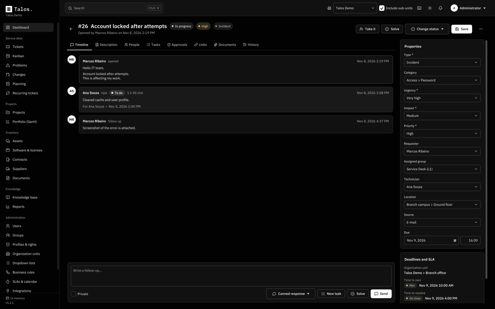

<p align="center">
  
</p>

<h1 align="center">Talos<br><sub><sup><sup><sub>Copyright (©) 2026 Erik Pimenta</sub></sup></sup></sub></h1>

<p align="center">
  IT service management, help desk and asset inventory in a Windows desktop app: tickets with SLA deadlines counted in business hours, ITIL problems and changes, a Kanban board, project Gantt charts with the critical path, a technician schedule, inventory of equipment, software, licenses, contracts and suppliers, a knowledge base with self-service, reports with charts and integrations with Slack, Microsoft Teams, Discord and Google Chat.<br>
  Select several tickets and handle them at once with <b>bulk actions</b>, fold duplicates together with <b>merge</b> and see similar items before opening a new one.<br>
  Inspired by the GLPI architecture, with no website or web server: your data lives in the database you choose, from a local H2 file to a PostgreSQL, MySQL, MariaDB, SQL Server or Oracle server shared by the team.<br>
  One <code>Talos-1.2.1.exe</code> installer with Java built in, in Portuguese and English, light and dark themes in the neutral palette of Bento and Turno.<br>
  Ready to download and use.
</p>

<p align="center">
  Java 21 · Spring Boot 4.0 · Spring Data JPA · Hibernate · HikariCP · Flyway · JavaFX 21 · H2 · PostgreSQL · MySQL · MariaDB · SQL Server · Oracle · JNA (DPAPI) · jpackage + WiX · JUnit 5 · Testcontainers · Maven · ReportLab (manual)
</p>

---

> **Download and use:** get [Talos-1.2.1.exe](https://github.com/ravelroot/Information-Technology-Service-Management/raw/main/Talos-1.2.1.exe) (Windows 10/11 64-bit, Java included), run it and finish the wizard. Open **Talos** from the Start menu, pick a database (to try it out, **H2** needs no server) and create your administrator account: there is no default password. Just looking? **Explore without a database** opens the app with sample data. If Windows shows *Windows protected your PC*, click **More info → Run anyway** (the installer has no paid code signature).

> **Full manual (Portuguese):** [`Manual-Talos-Versão 1.2.1.pdf`](Manual-Talos-Vers%C3%A3o%201.2.1.pdf) walks through installation, first use, every screen, tab and button, administration, automatic jobs, security, architecture, database, build and tests (copy in [`docs/manual/`](docs/manual/Manual-Talos-Vers%C3%A3o%201.2.1.pdf)).

> **Database:** [`docs/banco-de-dados.md`](docs/banco-de-dados.md) documents all 43 tables with columns, types per database, keys, accepted values and relationships.

> **Version 1.2.1 (Current):** **new palette**, the same as Bento and Turno: in the light theme, a light gray background, white cards, black text and buttons and a light sidebar, with the open item in an outlined card; in the dark theme, a black background, graphite cards and white text and buttons. Color is kept for status only (green, amber and red), and the categories of new installations follow the same palette. Screenshots, banners and the PDF manual were redone. No new tables: install over 1.0.0, 1.1.0 or 1.2.0.

> **Version 1.2.0 (Previous):** **bulk actions** on ticket, problem and change lists (select with Ctrl, Shift or <kbd>Ctrl</kbd> + <kbd>A</kbd>, then assign, change status, urgency or category, post the same follow-up or move to the trash at once), **merge duplicates** into a main item, **duplicate** items, **similar items** in the new-ticket form and three new reports: **First response**, **Backlog aging** and **Top requesters**. It also makes database search accent-insensitive and fixes weekend SLA warnings, changes stuck after a refusal, rules that reset priority, recurring tickets, project rollup and CSV parsing, and tightens permissions. No new tables: install over 1.0.0 or 1.1.0. Details in [Bulk actions and merge (1.2.0)](#bulk-actions-and-merge-120).

> **Version 1.0.0 (Previous):** first release. Tickets, problems and changes with ITIL workflows, priority matrix, business-hours SLA, approvals and satisfaction surveys; Kanban, Gantt, portfolio and schedule; inventory, software, licenses, contracts and suppliers; knowledge base and self-service; org units, per-module profiles, business rules, audit and trash; six databases and a `.exe` installer.

> **Português:** [README.md](README.md).

<p align="center">
  
</p>

## What Talos does

- **Tickets:** incidents and requests with urgency and impact; priority comes from a GLPI-style matrix and priority 6 (Critical) is manual. Ready-made views, filters and CSV export.
- **SLA:** time to own (TTO) and time to resolve (TTR) per priority, counted in business hours with holidays and paused while the ticket is pending, with automatic at-risk and breach alerts.
- **Timeline:** public or private follow-ups, **canned responses**, tasks with time spent, solutions accepted or refused by the requester and 1–5 star satisfaction surveys.
- **Problems and changes:** symptoms, root cause and impact; change type, risk, rollout and backout plans, checklist and an **approval** workflow done by someone else.
- **People:** several assignees per item, followers, observer groups, links between items (related, duplicates, caused by, depends on), affected assets and documents.
- **Bulk actions (1.2.0):** assign, change status, urgency or category, post the same follow-up, duplicate, merge or move to the trash many items at once, each one checked with the same permissions as its own screen.
- **Merge and duplicate (1.2.0):** fold repeated tickets into a main item, copying description, follow-ups, tasks, people and assets, or create a fresh copy of any item.
- **Similar items (1.2.0):** while you type the title of a new item, up to four open items with a similar title show up as links.
- **Kanban, projects and schedule:** drag cards to change status; Gantt with dependencies, milestones, critical path and automatic rescheduling; weekly technician schedule with `.ics` export.
- **Inventory:** computers, servers, monitors, printers, network gear, phones and peripherals with tag, serial, IP, MAC and warranty; connections, installed software, license compliance, contracts, suppliers, documents and CSV import/export.
- **Knowledge base and self-service:** Markdown articles with categories, drafts and FAQ, and a self-service portal for end users.
- **Reports:** 13 reports with charts and CSV export, including the new **First response**, **Backlog aging** and **Top requesters**.
- **Administration:** org unit hierarchy, per-module profiles granted per unit, groups, configurable lists, business rules with a built-in tester, SLAs, calendar and holidays, recurring tickets, field-level audit, trash and settings.
- **Integrations:** webhooks for Slack, Teams, Discord, Google Chat and signed generic JSON, with a test button and the latest deliveries.
- **Interface:** light and dark themes, Portuguese and English, command palette, shortcut guide, 50%–175% zoom, smooth animations and a **demo mode** without a database.

## Bulk actions and merge (1.2.0)

On the **Tickets**, **Problems** or **Changes** list, users who can edit select several items with Ctrl or Shift + click (or <kbd>Ctrl</kbd> + <kbd>A</kbd> for the whole page) and use the **Bulk actions** button next to export, or the right-click menu.

| Action | What it does |
|---|---|
| Assign to me / Assign… | Sets the technician and/or group for every selected item, keeping whatever is left blank (Assign right) |
| Change status | Moves every item to the chosen status following the workflow; solving and closing still need a solution |
| Urgency | Changes urgency and recomputes priority from the matrix |
| Change category… | Sets the category on every item |
| Add follow-up… | Posts the same text on every item, public or private |
| Merge selected… | You pick the main item; the others are copied into it and closed as duplicates |
| Duplicate | With one item selected, creates a fresh copy and opens it |
| Move to trash / Restore | Deletes or restores every item (Delete right) |

Each item is saved on its own; if some fail, the others are kept and a dialog lists the number and reason of each failure (up to 500 items at a time). A merged duplicate gets a follow-up pointing to the main item, the **Duplicates** link and is closed (changes are canceled). Merge is also available on the item screen under **⋯ → Merge into another item…**.

| Fix | Now |
|---|---|
| Database search | Ignores accents on all six databases, like demo mode |
| SLA at risk | Counts only business hours for business-hours SLAs |
| Change approval | The latest answer from each approver wins, so a change can be approved after a refusal |
| Business rules | Priority is recomputed only when a rule changes urgency or impact; **does not contain** works for requester groups |
| Recurring tickets | A failing template no longer blocks the others |
| Projects | Parent task progress and dates roll up through every level |
| Security | Asset CSV import, org unit changes, trash, task deletion and ticket people now check permissions and visibility |
| CSV | Quotes inside a field are kept and impossible dates such as 31/02 are rejected |

## Keyboard shortcuts

| Shortcut | Action |
|---|---|
| <kbd>Ctrl</kbd> + <kbd>K</kbd> | Command palette |
| <kbd>Ctrl</kbd> + <kbd>N</kbd> | New ticket |
| <kbd>Ctrl</kbd> + <kbd>Shift</kbd> + <kbd>N</kbd> | Go to Tickets |
| <kbd>F1</kbd> / <kbd>F5</kbd> / <kbd>Esc</kbd> | Shortcut guide / refresh / close |
| <kbd>Ctrl</kbd> + <kbd>A</kbd> on a list | Select the whole page for bulk actions |
| Ctrl or Shift + click, <kbd>Shift</kbd> + <kbd>↑</kbd> / <kbd>↓</kbd> | Select several items |
| <kbd>Enter</kbd> on a table | Open the selected item |
| <kbd>Ctrl</kbd> + mouse wheel, <kbd>Ctrl</kbd> + <kbd>+</kbd> / <kbd>-</kbd> / <kbd>0</kbd> | Zoom |

## Architecture

Hexagonal architecture in three Maven modules: `talos-domain` (pure Java entities and services, rule engine, SLA calendar, critical path, permissions, bulk actions, merge and webhooks, plus an in-memory store for tests and demo mode), `talos-infrastructure` (headless Spring Boot, Spring Data JPA/Hibernate, Flyway migrations for each database, JDBC drivers and scheduled jobs coordinated through the database) and `talos-desktop` (JavaFX UI, found by the backend through `ServiceLoader`).

## How to run

1. Download [**Talos-1.2.1.exe**](https://github.com/ravelroot/Information-Technology-Service-Management/raw/main/Talos-1.2.1.exe), run it and open **Talos** from the Start menu.
2. Pick the database and test the connection; tables are created automatically.
3. Create the organization and your administrator account, sign in and finish the guided setup (organization, units, locations, team, business hours and categories).

To build from source on Windows, run `scripts\build-windows.cmd`: it finds or downloads JDK 21, Maven and WiX Toolset 3 into `.tools`, runs `mvn clean verify` and writes `Talos-1.2.1.exe` to the project root. Elsewhere, with JDK 21+ and Maven 3.9+: `mvn clean verify` and `java -jar talos-desktop/target/app/talos.jar`.

## Database

| Database | Minimum version |
|---|---|
| **H2** (embedded) | included |
| **PostgreSQL** | 12 |
| **MySQL** | 8.0 |
| **MariaDB** | 10.6 |
| **Microsoft SQL Server** | 2017 |
| **Oracle Database** | 19c |

Create an empty database and a user allowed to create tables; Talos creates the schema with Flyway. Versions 1.2.0 and 1.2.1 add no tables or columns. Configuration lives in `%APPDATA%\Talos\talos.properties` (the database password is encrypted with Windows DPAPI), the embedded H2 database in `%LOCALAPPDATA%\Talos\database` and logs in `%LOCALAPPDATA%\Talos\logs`.

## Development and tests

```bash
mvn verify
```

Domain tests cover the ticket lifecycle, business-hours SLA, priority matrix, rule engine, critical path, permissions, security, CSV, integrations, bulk actions, merge, duplicate, similar items, the new reports and the 1.2.0 fixes; infrastructure tests boot Spring Boot on H2, run the Flyway migrations, check optimistic locking, accent-insensitive search and that every database script matches the entities; UI tests check that both translations are complete. `DatabaseCompatibilityTest` runs the persistence suite against real servers with Docker (`-Dtalos.databases=postgresql,mysql,mariadb,sqlserver,oracle`).

## Quality and security

No default password, PBKDF2-HMAC-SHA256 with 600,000 iterations, login without user enumeration and with progressive delay, lockout limits, inactivity timeout and continuous session revalidation, permissions enforced in the service layer (including every item of bulk actions and merge), no privilege escalation, a protected Super-Administrator profile, DPAPI-encrypted database password, formula-safe CSV export, time-limited regular expressions, certificate validation on SQL Server, no network port on the embedded H2 and the JVM attach mechanism disabled. Report vulnerabilities as described in [SECURITY.md](SECURITY.md). Third-party components and their licenses are listed in [THIRD-PARTY-NOTICES.md](THIRD-PARTY-NOTICES.md).

## License

Copyright (©) 2026 Erik Pimenta

This project is distributed under the [MIT](LICENSE) license. You may use, copy, modify and redistribute the code, including for commercial purposes, as long as you keep the copyright notice and the license text.
