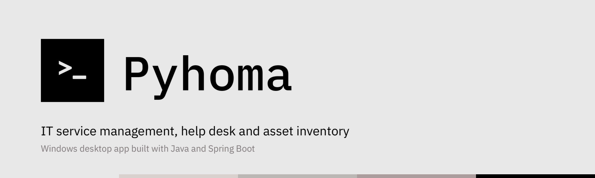
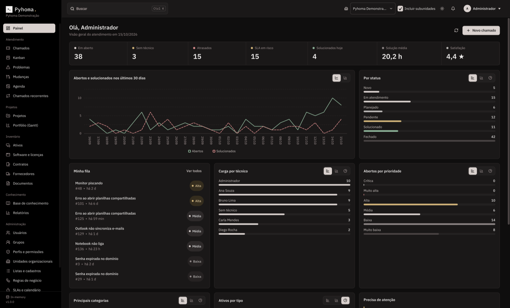
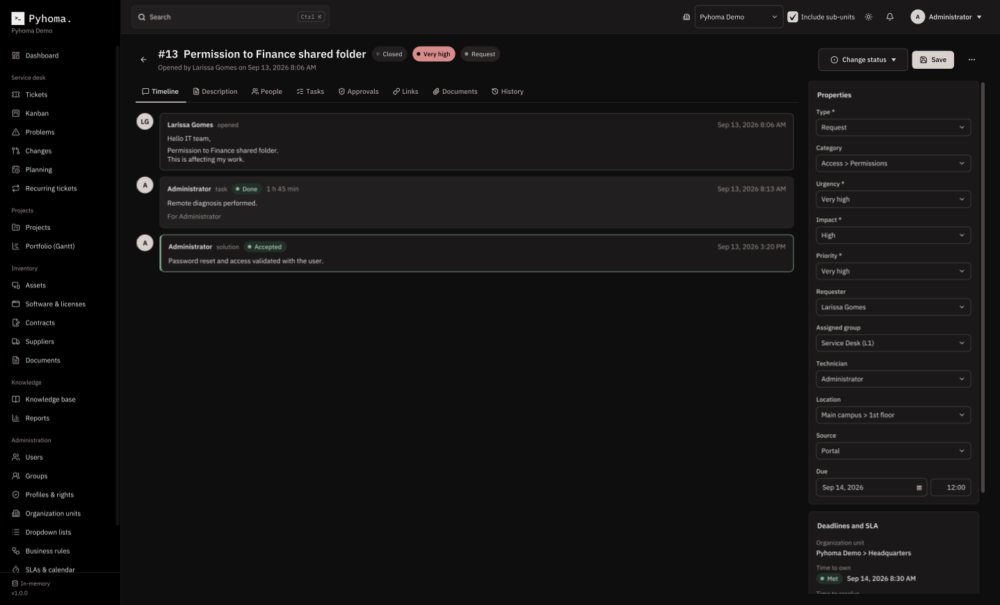
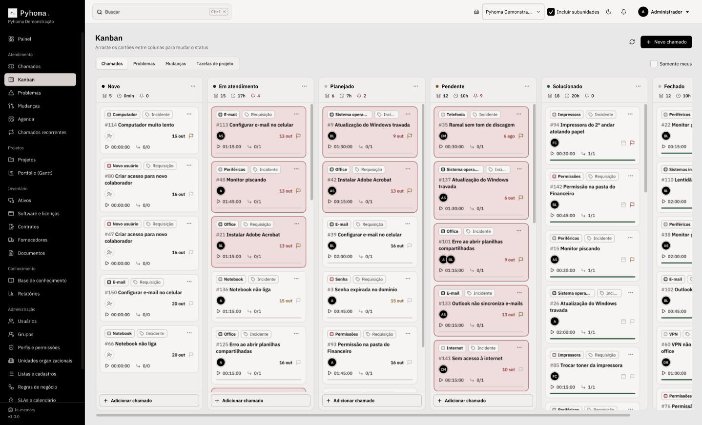
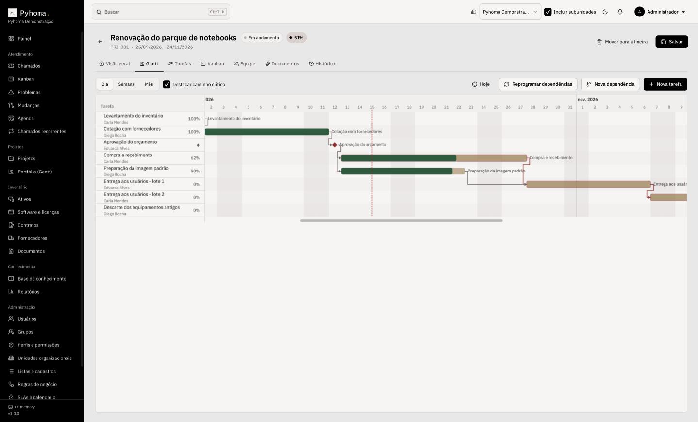
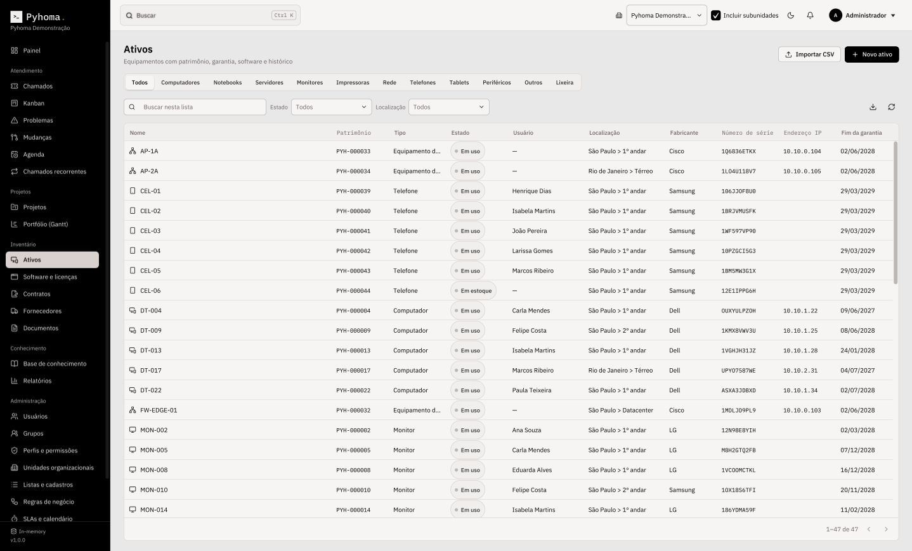

<p align="center">
  
</p>

<p align="center">
  <b>IT service management, help desk and asset inventory on your own computer.</b><br>
  A Windows desktop application inspired by the architecture of GLPI, built with Java and Spring Boot.
</p>

<p align="center">
  
  
  
  
  
</p>

<p align="center">
  <a href="README.md">Leia em português</a>
</p>

---

<p align="center">
  
</p>

**Pyhoma.** puts what an IT team uses every day into one program: tickets with SLA deadlines, ITIL problems and changes, a Kanban board, Gantt schedules, technician planning, an inventory of hardware, software and contracts, a knowledge base and reports.

It runs on Windows like any other program: install it with a wizard, pick the folder, and open it from the Start menu. There is no website and no web server. Your data lives in the database **you** choose, from a local H2 file to a PostgreSQL, MySQL, MariaDB, SQL Server or Oracle server shared by the team.

The interface is available in Portuguese (Brazil) and English, with light and dark themes.

## Features

**Service desk (ITIL)**
- Incidents and requests with urgency, impact and a priority matrix, as in GLPI.
- Time-to-own and time-to-resolve SLAs per priority, counted in business hours with holidays and paused while a ticket is pending. Alerts when a deadline is at risk or breached.
- A timeline of follow-ups (public or private), tasks with time spent, solutions the requester accepts or refuses, and a satisfaction survey.
- Problems with symptoms, root cause and impact analysis; changes with rollout plan, backout plan, checklist, risk and an approval flow.
- A lean **new item** form: title, board (tickets, problems or changes), type, category, assignees, followers and a text box to describe the request. The full form is one click away.
- **One or more assignees** per item, picked by anyone regardless of profile. **Followers** only watch: they see the item and get its updates. Manage them in the item's **People** tab or from the Kanban card menu.
- **Ticket categories** created and deleted by the administrator right from the Kanban board or the new item form, with colors and subcategories. Deleting a category leaves its tickets uncategorized.
- Links between items, affected assets, following groups and attached documents.
- Business rules that classify and route tickets when they open, with a built-in tester.
- Recurring tickets and automatic closing of solved tickets.

**Kanban and Gantt**
- Kanban boards for tickets, problems, changes and project tasks. Drag a card to change its status; only allowed transitions are accepted.
- Each column shows its item count, total time worked and how many are overdue, and ends with **Add ticket**: the new card shows up in that column. The column **⋯** menu sorts by priority, creation date, due date or title.
- Each card shows the category (in its color) and type, the number and title, the assignees, the due date, a priority flag, the time worked and the tasks done. Overdue cards stand out.
- Project Gantt charts with dependencies, milestones, critical path and automatic rescheduling. Drag a bar to move a task or its edge to change the duration.
- A portfolio timeline of every active project, and a weekly planning view of each technician's tasks.

**Asset inventory**
- Computers, laptops, servers, monitors, printers, network devices, phones, tablets and peripherals, with asset tag, serial number, IP, MAC, warranty and owners.
- Network connections, installed software and license compliance; supplier contracts with notice periods and renewal; warranty and contract expiration alerts.
- CSV import and export, including a ready-made template.

**Knowledge base and self-service**
- Markdown articles with categories, drafts and an FAQ.
- A self-service interface where end users open and follow their own tickets.

**GLPI-style administration**
- Organization units in a hierarchy (GLPI "entities"), profiles with per-module rights granted per unit, groups, configurable dropdown lists, a full audit log and a trash bin.
- Reports with charts, global search (<kbd>Ctrl</kbd> + <kbd>K</kbd>) and notifications.
- [**User manual (PDF, Portuguese)**](docs/manual/Manual-Pyhoma-Vers%C3%A3o%201.0.0.pdf) covering every screen, feature, shortcut and technical detail.

**Interface**
- Minimalist palette in grays, sand and black (`#E8E8E8`, `#D9D1CE`, `#BAB7B5`, `#AB9D9D`, `#000000`) in **light** and **dark** themes.
- Smooth motion: animated page transitions, smooth scrolling, lively cards and counters. The window opens maximized, filling the screen.
- **Zoom** defaults to 75% (like 75% in a web browser). Change it with <kbd>Ctrl</kbd> + mouse wheel or <kbd>Ctrl</kbd> + <kbd>+</kbd> / <kbd>-</kbd>, from 50% to 175%; <kbd>Ctrl</kbd> + <kbd>0</kbd> goes back to 75%. The level is remembered.
- **Dashboard charts** as bars, columns, line or donut: each chart has buttons to switch the view, and the choice is remembered.
- **Demo mode**: try every screen with sample data, no database needed.

## Screenshots

| | |
|---|---|
|  |  |
| Ticket timeline and properties | Kanban with categories, assignees, due dates and counters |
|  |  |
| Gantt with dependencies and critical path | Asset inventory |

> The screenshots show the demo data generated by the program itself. Every name, email and number is fictional.

## Installation

1. Open the [**Releases**](../../releases/latest) page.
2. Download `Pyhoma-1.0.0.exe`.
3. Run the installer, choose the installation folder and finish.
4. Open **Pyhoma** from the Start menu or the desktop shortcut.

The installer bundles Java and every library it needs. Windows SmartScreen may warn about an unknown publisher because the installer isn't code-signed: click **More info**, then **Run anyway**.

Uninstalling (Settings › Apps) also deletes everything Pyhoma. kept on the computer: settings, logs and the local H2 database. The next installation starts from scratch at the welcome screen. Server databases (PostgreSQL, MySQL, SQL Server, Oracle) are left untouched.

Requirements: Windows 10 or 11 (64-bit), 4 GB of RAM, 400 MB of disk plus the database.

## First run

A four-step wizard opens the first time:

1. **Database**: choose where the data will live and click *Test connection*. Tables are created automatically, following the [data model](docs/banco-de-dados.md).
2. **Organization and administrator**: name your organization and create the administrator account with your own password. **There is no default user or password.**
3. **Sign in** with the account you just created.
4. **Initial setup**: guided screens for your organization's basics, each saved to the database as soon as you click save. Required: organization name and contact email, at least one location, at least one technical group and the business hours. Optional: units (branches, departments) and extra ticket categories.

After that, tickets, assets, contracts, projects and articles start **empty**, with no sample data. Profiles, SLAs per priority, holidays and common lists are created for you and can be adjusted under **Administration**.

Just want to look around? Click **Explore without a database** on the welcome screen: Pyhoma. opens with sample data, every screen works and nothing is saved. A bar at the top reminds you it is a demo and takes you straight to the database setup when you are ready.

If the program is closed before step 2 is finished, nothing is kept: the wizard starts over the next time it opens.

Then add people under **Administration › Users** and give each one a profile: Super-Admin, Supervisor, Technician, Observer or Self-Service. Every computer on the team installs Pyhoma. and points to the **same database server**; notifications, SLA alerts and scheduled jobs are coordinated through the database.

## Database

| Database | Minimum version | Best for |
|---|---|---|
| **H2** (embedded) | bundled | Evaluation or a single computer |
| **PostgreSQL** | 12 | Teams (recommended) |
| **MySQL** | 8.0 | Teams |
| **MariaDB** | 10.6 | Teams |
| **Microsoft SQL Server** | 2017 | Teams already on SQL Server |
| **Oracle Database** | 19c | Teams already on Oracle |

For a server, create an empty database and a user allowed to create tables first, using a strong password of your own. Ready-to-use SQL for each server is in the [Portuguese README](README.md#banco-de-dados). The schema is versioned with **Flyway**, so upgrades apply new migrations on the first connection. The full data model (tables, columns, relationships, accepted values and types per database) is documented in [docs/banco-de-dados.md](docs/banco-de-dados.md) (Portuguese).

| What | Where |
|---|---|
| Connection settings | `%APPDATA%\Pyhoma\pyhoma.properties` |
| Embedded H2 database | `%LOCALAPPDATA%\Pyhoma\database` (or the folder you choose) |
| Logs | `%LOCALAPPDATA%\Pyhoma\logs\pyhoma.log` |

## Building from source

On Windows, double-click `scripts\build-windows.cmd`. It finds (or downloads into `.tools`) a JDK 21, Maven and the WiX Toolset 3, runs `mvn clean verify`, and writes `Pyhoma-1.0.0.exe` in the project root (outside Git). Add `-SkipTests` to go faster.

Manually, with JDK 21+ and Maven 3.9+:

```bash
mvn clean verify
java -jar pyhoma-desktop/target/app/pyhoma.jar
```

## Architecture

Hexagonal (ports and adapters). Business rules know nothing about Spring, JPA or JavaFX.

| Module | Responsibility |
|---|---|
| `pyhoma-domain` | Entities, services, priority matrix, business calendar, rule engine, project scheduling (critical path), rights and auditing. Plain Java, with an in-memory repository for tests. |
| `pyhoma-infrastructure` | Spring Boot without a web server, Spring Data JPA/Hibernate, Flyway scripts for every database, JDBC drivers and scheduled jobs coordinated through a database lock. |
| `pyhoma-desktop` | JavaFX interface, first-run wizard, local settings and DPAPI encryption of the database password. Loads the backend through `ServiceLoader`. |

Pyhoma. uses no GLPI code. It borrows GLPI's proven concepts: entities, profiles and rights, a shared ITIL base for tickets, problems and changes, follow-ups, tasks, solutions and validations, business rules, SLAs with calendars, dropdowns, automatic actions, trash and history.

## Security and privacy

- No default password: the administrator account is created on first run.
- Passwords are hashed with PBKDF2-HMAC-SHA256 (600,000 iterations, random salt) and old hashes are upgraded at the next sign-in. Policy: 10 to 128 characters with letters and numbers, not containing the username or name, and not a common password.
- Sign-in gives no hints: unknown users, wrong passwords and locked accounts get the same answer and timing, with a short delay after each failure. Lockout limits can't be loosened beyond safe bounds.
- Sessions end after inactivity (15 minutes by default) and are revalidated every 30 seconds, so disabling an account or removing its profile takes effect immediately.
- Rights are enforced in the service layer. Nobody can grant profiles or rights greater than their own, change their own access, or manage a Super-Admin account without being one; at least one active Super-Admin always remains. Approvals must come from someone else.
- The database password is encrypted with Windows DPAPI, bound to your account and to Pyhoma.
- Document links accept only http(s), e-mail or non-executable files, and are confirmed before opening. CSV exports neutralize spreadsheet formulas. Rule regular expressions are size- and time-limited.
- SQL Server connections are encrypted with certificate validation (add `trustServerCertificate=true` for self-signed servers). Embedded H2 opens no network port. Flyway can't clean the database and no SQL or values are logged.
- Unexpected errors show a generic message; technical details stay in the local log. The installed app disables JVM attach.
- This repository contains no connections, passwords, keys or sample databases. Demo data is fictional. See [SECURITY.md](SECURITY.md) to report a vulnerability.

## Tests

`mvn verify` runs the domain tests (ticket lifecycle, business-hour SLAs, priority matrix, rule engine, critical path, rights, demo data), an H2 end-to-end test of the real Spring Boot backend, a check that every database's SQL matches the entities, and a translation completeness test. With Docker, add `-Dpyhoma.databases=postgresql,mysql,mariadb,sqlserver,oracle` to run the persistence suite against real servers.

## License and credits

[MIT License](LICENSE). Icons by [Lucide](https://lucide.dev) (ISC). Fonts: [IBM Plex](https://github.com/IBM/plex) (SIL OFL 1.1). Architecture inspired by [GLPI](https://glpi-project.org) by Teclib'; Pyhoma. is an independent project with no affiliation to GLPI or Teclib'. Third-party details in [THIRD-PARTY-NOTICES.md](THIRD-PARTY-NOTICES.md).
