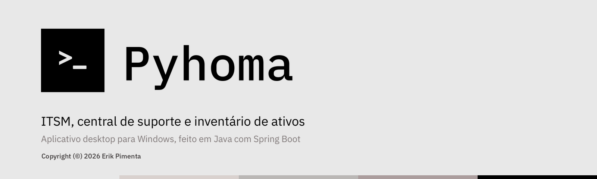
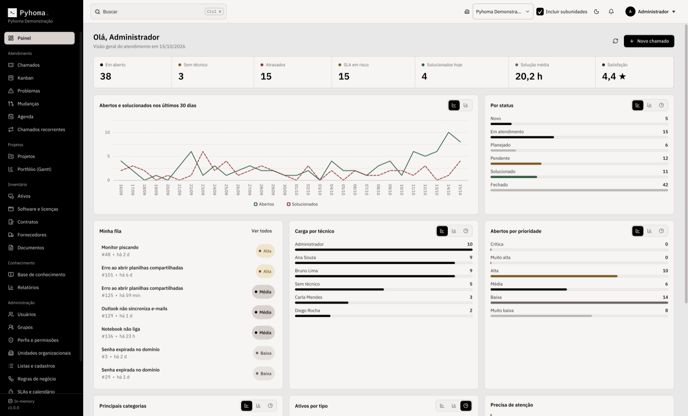
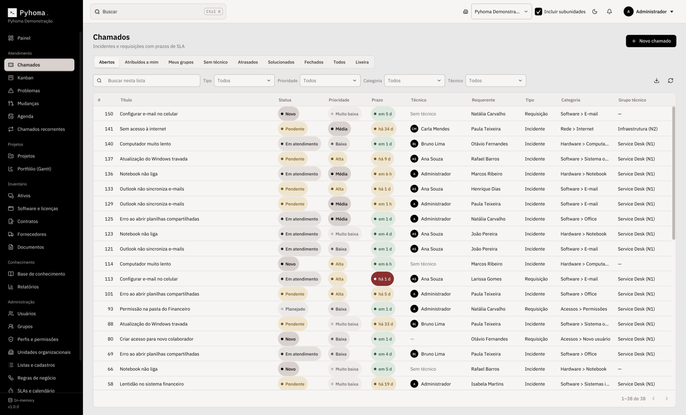
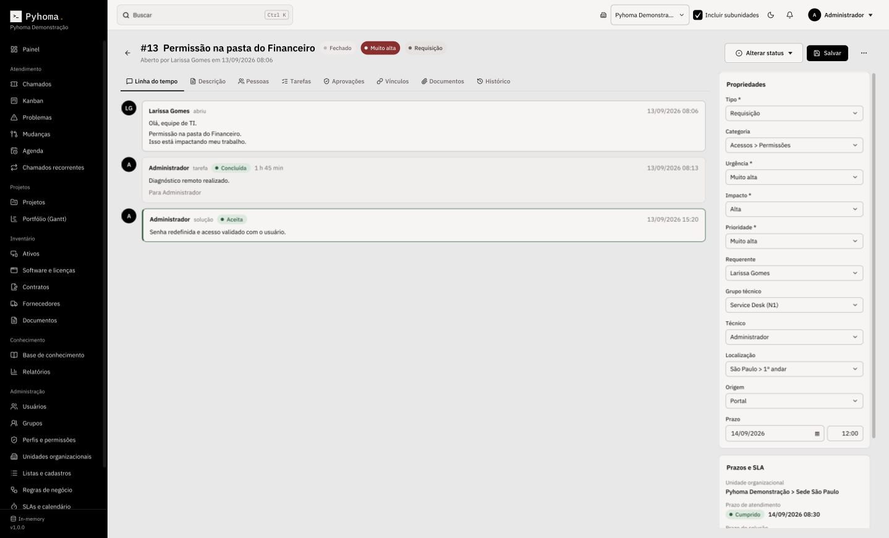
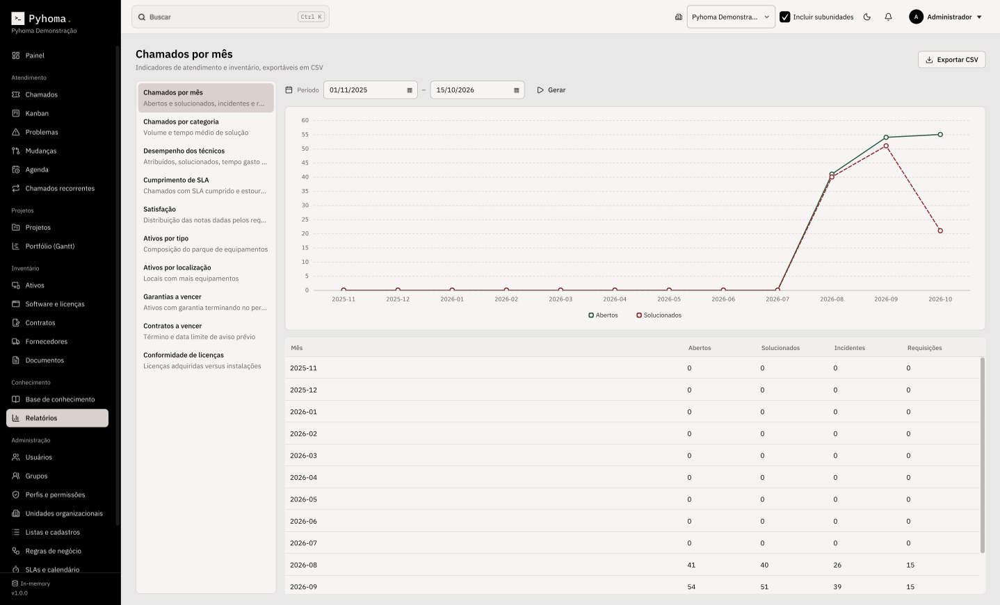
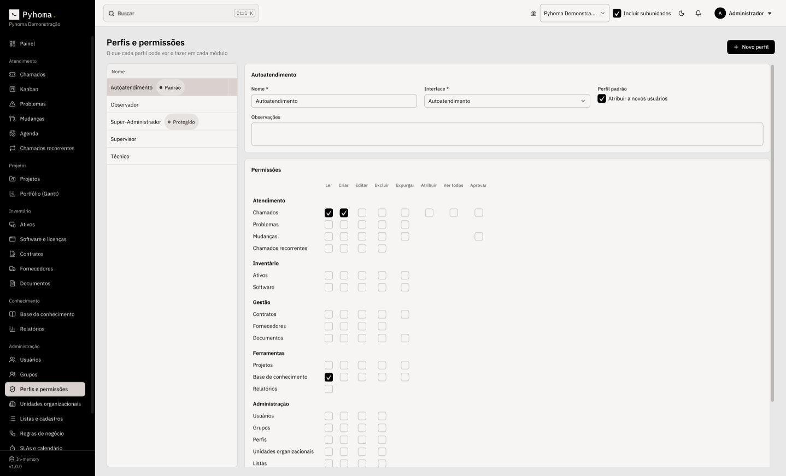
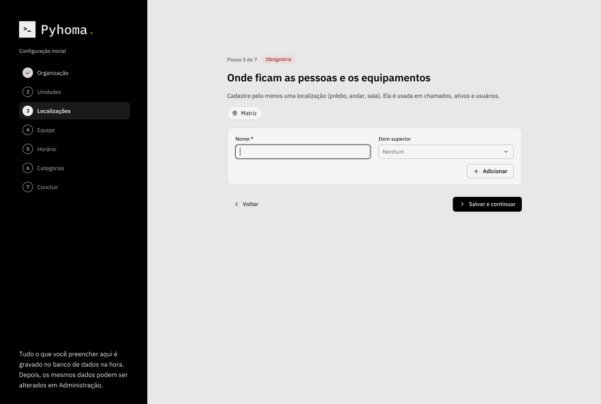
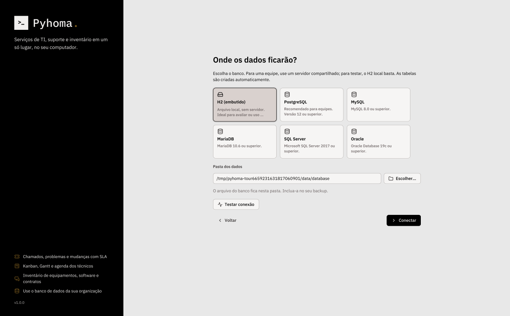
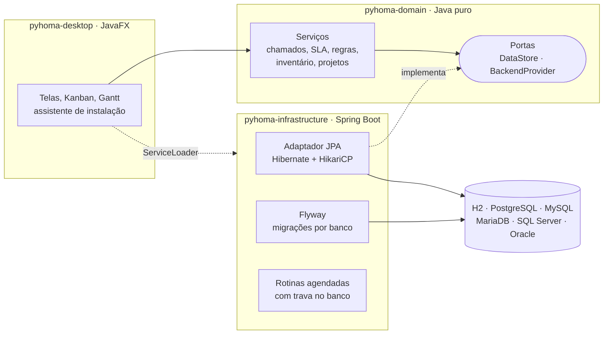

<p align="center">
  
</p>

<p align="center">
  <b>Gestão de serviços de TI, central de suporte e inventário de ativos para o seu computador.</b><br>
  Um aplicativo desktop para Windows, inspirado na arquitetura do GLPI, feito em Java com Spring Boot.
</p>

<p align="center">
  
  
  
  
  
</p>

<p align="center">
  <a href="README.en.md">Read in English</a>
</p>

---

<p align="center">
  
</p>

O **Pyhoma.** reúne em um só programa o que uma equipe de TI usa todos os dias: chamados com prazos de SLA, problemas e mudanças no modelo ITIL, quadro Kanban, cronograma de Gantt, agenda dos técnicos, inventário de equipamentos, software e contratos, base de conhecimento e relatórios.

Ele roda no Windows como qualquer outro programa: você instala com um assistente, escolhe a pasta e abre pelo menu Iniciar. Não há site nem servidor web. Os dados ficam no banco de dados que **você** escolher, do arquivo local H2 a um PostgreSQL, MySQL, MariaDB, SQL Server ou Oracle compartilhado pela equipe.

## Sumário

- [Recursos](#recursos)
- [Telas](#telas)
- [Instalação](#instala%C3%A7%C3%A3o)
- [Primeiro uso](#primeiro-uso)
- [Banco de dados](#banco-de-dados)
- [Compilar a partir do código](#compilar-a-partir-do-c%C3%B3digo)
- [Arquitetura](#arquitetura)
- [Segurança e privacidade](#seguran%C3%A7a-e-privacidade)
- [Testes](#testes)
- [Contribuindo](#contribuindo)
- [Licença e créditos](#licen%C3%A7a-e-cr%C3%A9ditos)

## Recursos

### Central de serviços (ITIL)

- **Chamados** do tipo incidente ou requisição, com urgência e impacto. A prioridade é calculada por uma matriz, como no GLPI.
- **SLA** de atendimento (TTO) e de solução (TTR) por prioridade, contados em horário comercial, com feriados e pausa enquanto o chamado está pendente. Alertas automáticos quando o prazo entra em risco ou estoura.
- **Linha do tempo** com acompanhamentos (públicos ou privados), tarefas com tempo gasto, solução com aceite ou recusa do requerente e pesquisa de satisfação.
- **Problemas** com sintomas, causa raiz e análise de impacto; **mudanças** com plano de implantação, plano de retorno, checklist, risco e fluxo de **aprovação**.
- **Novo item** em um formulário enxuto: título, quadro (chamados, problemas ou mudanças), tipo, categoria, responsáveis, seguidores e uma caixa de texto para explicar o pedido. O formulário completo continua a um clique.
- **Um ou mais responsáveis** por item, escolhidos por qualquer pessoa, seja qual for o perfil. **Seguidores** só acompanham: veem o item e recebem as atualizações. Tudo fica na aba **Pessoas** do item ou no menu do cartão do Kanban.
- **Categorias de chamados** criadas e excluídas pelo administrador direto no Kanban ou no novo item, com cor e subcategorias. Ao excluir, os chamados da categoria ficam sem categoria.
- **Vínculos** entre chamados, problemas e mudanças, ativos afetados, grupos que acompanham e documentos anexados.
- **Regras de negócio** que classificam e atribuem chamados na abertura (se o título contém "impressora", atribuir ao grupo Infraestrutura), com testador embutido.
- **Chamados recorrentes** para rotinas como backup e verificação mensal.
- **Fechamento automático** de chamados solucionados após alguns dias.

### Visões Kanban e Gantt

- **Kanban** de chamados, problemas, mudanças e tarefas de projeto. Arraste o cartão para mudar o status; o fluxo respeita as transições permitidas.
- Cada coluna mostra quantos itens tem, o tempo trabalhado somado e quantos estão atrasados, e termina com **Adicionar chamado**: o cartão novo aparece na própria coluna. O menu **⋯** da coluna ordena por prioridade, data de criação, prazo ou título.
- Cada cartão traz a categoria (com a cor dela) e o tipo, o número e o título, os responsáveis, o prazo, a bandeira de prioridade, o tempo trabalhado e as tarefas concluídas. Cartões atrasados ficam destacados.
- **Gantt** de cada projeto com dependências, marcos, caminho crítico e reprogramação automática. Arraste uma barra para mover a tarefa ou a borda para mudar a duração.
- **Portfólio** com todos os projetos ativos em uma única linha do tempo, por dia, semana ou mês.
- **Agenda** semanal das tarefas planejadas de cada técnico.

### Inventário de ativos

- Computadores, notebooks, servidores, monitores, impressoras, equipamentos de rede, telefones, tablets e periféricos, com patrimônio, número de série, IP, MAC, garantia e responsáveis.
- **Conexões de rede** entre ativos, **software instalado** e **licenças** com controle de conformidade (licenças adquiridas versus instalações).
- **Contratos** com fornecedores, aviso prévio e renovação; alertas de vencimento de garantias e contratos.
- **Importação e exportação CSV** (inclusive um modelo de planilha pronto).

### Base de conhecimento e autoatendimento

- Artigos em Markdown com categorias, rascunhos e FAQ.
- **Interface de autoatendimento** para usuários finais: abrir chamados, acompanhar os seus e consultar o FAQ.

### Administração no estilo GLPI

- **Unidades organizacionais** em hierarquia (as "entidades" do GLPI), com visibilidade herdada pelas subunidades.
- **Perfis e permissões** por módulo (ler, criar, editar, excluir, expurgar, atribuir, ver todos, aprovar), concedidos por unidade.
- **Grupos** técnicos e de requerentes, **listas** configuráveis (localizações, categorias, modelos, fabricantes…), **auditoria** completa de alterações e **lixeira** com restauração.
- **Relatórios** com gráficos: chamados por mês e categoria, desempenho dos técnicos, cumprimento de SLA, satisfação, ativos por tipo e local, vencimentos e conformidade de licenças.
- Busca global (<kbd>Ctrl</kbd> + <kbd>K</kbd>), notificações, português e inglês.
- [**Manual de uso em PDF**](docs/manual/Manual-Pyhoma-Vers%C3%A3o%201.0.0.pdf) com todas as telas, funções, atalhos e informações técnicas.

### Interface

- Paleta minimalista em cinzas, areia e preto (`#E8E8E8`, `#D9D1CE`, `#BAB7B5`, `#AB9D9D`, `#000000`) nos temas **claro** e **escuro**.
- Movimento suave: troca de telas com transição, rolagem suave, cartões e indicadores animados. A janela abre maximizada, ocupando a tela inteira.
- **Zoom** padrão de 75% (como 75% no navegador). Ajuste com <kbd>Ctrl</kbd> + rolagem do mouse ou <kbd>Ctrl</kbd> + <kbd>+</kbd> / <kbd>-</kbd>, de 50% a 175%; <kbd>Ctrl</kbd> + <kbd>0</kbd> volta a 75%. O nível escolhido fica salvo.
- **Gráficos do Painel** em barras, colunas, linha ou rosca: cada gráfico tem botões para trocar a visualização, e a escolha fica salva.
- **Modo demonstração**: conheça todas as telas com dados fictícios, sem conectar um banco.

## Telas

| | |
|---|---|
|  |  |
| **Chamados** com filtros, prioridade e prazo de SLA | **Linha do tempo** do chamado, solução e propriedades |
|  |  |
| **Kanban** com categorias, responsáveis, prazos e contadores | **Gantt** com dependências e caminho crítico |
|  |  |
| **Inventário** de equipamentos | **Relatórios** exportáveis em CSV |
|  |  |
| **Perfis e permissões** por módulo | **Tema escuro** e interface em inglês |

> As telas mostram os dados de demonstração gerados pelo próprio programa. Todos os nomes, e-mails e números são fictícios.

## Instalação

### Opção 1: baixar o instalador

1. Abra a página [**Releases**](../../releases/latest) deste repositório.
2. Baixe `Pyhoma-1.0.0.exe`.
3. Execute o instalador, escolha a pasta de instalação e conclua.
4. Abra o **Pyhoma** pelo menu Iniciar ou pelo atalho na área de trabalho.

O instalador já inclui o Java e todas as bibliotecas necessárias. Não é preciso instalar mais nada.

Ao desinstalar (Configurações › Aplicativos), o Pyhoma. apaga também tudo o que guardou no computador: configurações, logs e o banco local H2. Na próxima instalação ele começa do zero, pela tela de boas-vindas. Bancos em servidor (PostgreSQL, MySQL, SQL Server, Oracle) não são tocados.

> O Windows SmartScreen pode avisar que o editor é desconhecido, porque o instalador não é assinado digitalmente. Clique em **Mais informações** e depois em **Executar assim mesmo**.

### Opção 2: gerar o instalador você mesmo

Veja [Compilar a partir do código](#compilar-a-partir-do-c%C3%B3digo). Um duplo clique em `scripts\build-windows.cmd` gera o instalador `Pyhoma-1.0.0.exe` na raiz do projeto.

### Requisitos

| | Mínimo |
|---|---|
| Sistema | Windows 10 ou 11, 64 bits |
| Memória | 4 GB (o programa usa até 1 GB) |
| Disco | 400 MB para o programa, mais o espaço do banco |
| Banco | H2 embutido, ou um servidor da lista abaixo |

## Primeiro uso

Na primeira vez que o programa abre, um assistente de quatro passos aparece:

1. **Banco de dados**: escolha onde os dados ficarão e clique em *Testar conexão*. As tabelas são criadas automaticamente, seguindo o [modelo do banco](docs/banco-de-dados.md).
2. **Organização e administrador**: dê um nome à organização e crie a conta de administrador com a sua própria senha. **Não existe usuário ou senha padrão.**
3. **Entrar**: use o login e a senha que você acabou de criar.
4. **Configuração inicial**: telas guiadas para cadastrar a base da sua organização. Cada item é gravado no banco assim que você clica em salvar.

| Etapa | Obrigatória | O que você cadastra |
|---|:-:|---|
| Organização | sim | Nome e e-mail de contato (telefone e endereço opcionais) |
| Unidades | | Filiais e departamentos |
| Localizações | sim | Pelo menos um prédio, andar ou sala |
| Equipe | sim | Pelo menos um grupo técnico; técnicos podem ser adicionados agora ou depois |
| Horário | sim | Dias e horário de atendimento usados pelo SLA |
| Categorias | | Categorias de chamado além das que já vêm prontas |

Depois disso, chamados, ativos, contratos, projetos e artigos começam **vazios**, sem nenhum dado fictício, para você preencher como preferir. Perfis, SLAs por prioridade, feriados nacionais e listas comuns (origens, estados de ativo, tipos de contrato…) já vêm criados e podem ser ajustados em **Administração**.

<p align="center">
  
</p>

Quer só conhecer o programa? Clique em **Explorar sem banco de dados** na tela inicial: o Pyhoma. abre com dados fictícios, todas as telas funcionam e nada é salvo. Uma faixa no topo lembra que é uma demonstração e leva direto à configuração do banco quando você quiser.

Se o programa for fechado antes de concluir o passo 2, nada fica salvo: na próxima abertura o assistente recomeça do início.

<p align="center">
  
</p>

Depois disso, cadastre as pessoas em **Administração › Usuários** e dê a cada uma um perfil:

| Perfil | Para quem |
|---|---|
| Super-Administrador | Configura tudo. Perfil protegido. |
| Supervisor | Coordena a equipe: vê e atribui todos os chamados, aprova mudanças, vê relatórios. |
| Técnico | Atende chamados, cuida do inventário e dos projetos. |
| Observador | Apenas consulta. |
| Autoatendimento | Usuários finais: abrem e acompanham os próprios chamados e leem o FAQ. |

Cada computador da equipe instala o Pyhoma. e aponta para o **mesmo servidor de banco**. Notificações, alertas de SLA e rotinas automáticas são coordenados entre as estações pelo próprio banco.

## Banco de dados

O banco é escolha sua. O Pyhoma. traz os drivers e os scripts de criação para todos estes:

| Banco | Versão mínima | Indicado para |
|---|---|---|
| **H2** (embutido) | já incluso | Avaliação ou uso em um único computador |
| **PostgreSQL** | 12 | Equipes (recomendado) |
| **MySQL** | 8.0 | Equipes |
| **MariaDB** | 10.6 | Equipes |
| **Microsoft SQL Server** | 2017 | Equipes que já usam SQL Server |
| **Oracle Database** | 19c | Equipes que já usam Oracle |

O modelo completo do banco (tabelas, campos, relacionamentos, valores aceitos e tipos em cada banco) está em [**docs/banco-de-dados.md**](docs/banco-de-dados.md).

Para um servidor, crie antes um banco vazio e um usuário com permissão para criar tabelas. Exemplos (troque o nome e **use uma senha forte sua**):

<details>
<summary>PostgreSQL</summary>

```sql
CREATE USER pyhoma WITH PASSWORD 'troque-esta-senha';
CREATE DATABASE pyhoma OWNER pyhoma ENCODING 'UTF8';
```
</details>

<details>
<summary>MySQL / MariaDB</summary>

```sql
CREATE DATABASE pyhoma CHARACTER SET utf8mb4 COLLATE utf8mb4_unicode_ci;
CREATE USER 'pyhoma'@'%' IDENTIFIED BY 'troque-esta-senha';
GRANT ALL PRIVILEGES ON pyhoma.* TO 'pyhoma'@'%';
```
</details>

<details>
<summary>SQL Server</summary>

```sql
CREATE DATABASE pyhoma;
GO
CREATE LOGIN pyhoma WITH PASSWORD = 'troque-esta-senha';
GO
USE pyhoma;
CREATE USER pyhoma FOR LOGIN pyhoma;
ALTER ROLE db_owner ADD MEMBER pyhoma;
```
O Pyhoma. valida o certificado do servidor. Se o seu SQL Server usa um certificado próprio (autoassinado), informe em *Parâmetros extras*: `trustServerCertificate=true`.
</details>

<details>
<summary>Oracle</summary>

```sql
CREATE USER pyhoma IDENTIFIED BY "troque-esta-senha" QUOTA UNLIMITED ON USERS;
GRANT CREATE SESSION, CREATE TABLE, CREATE SEQUENCE TO pyhoma;
```
No campo *Banco*, informe o nome do serviço (por exemplo `FREEPDB1`).
</details>

Em *Parâmetros extras* você pode acrescentar opções do driver (por exemplo `ssl=true` no PostgreSQL) ou colar uma URL JDBC completa começando por `jdbc:`.

A estrutura do banco é versionada com **Flyway**: ao atualizar o Pyhoma., as novas migrações são aplicadas sozinhas na primeira conexão.

### Onde ficam os arquivos

| O quê | Onde |
|---|---|
| Configuração da conexão | `%APPDATA%\Pyhoma\pyhoma.properties` |
| Banco H2 embutido | `%LOCALAPPDATA%\Pyhoma\database` (ou a pasta que você escolher) |
| Logs | `%LOCALAPPDATA%\Pyhoma\logs\pyhoma.log` |

Nada é gravado na pasta de instalação. Para trocar de banco, use **Configurações › Banco de dados** ou o link *Usar outro banco de dados* na tela de login.

## Compilar a partir do código

### Jeito rápido (Windows)

```bat
git clone https://github.com/erikdevel0per/Information-Technology-Service-Management.git
cd Information-Technology-Service-Management
scripts\build-windows.cmd
```

O script:

1. procura um **JDK 21** e o **Maven**; se não encontrar, baixa versões portáteis para a pasta `.tools` (nada é instalado no sistema);
2. baixa o **WiX Toolset 3**, usado pelo `jpackage` para gerar o `.exe`;
3. compila e roda os testes (`mvn clean verify`);
4. gera `Pyhoma-1.0.0.exe` na raiz do projeto (fora do Git).

Opção: `scripts\build-windows.cmd -SkipTests` (mais rápido). O log completo fica em `build-logs\`.

### Manualmente

Requisitos: JDK 21 ou mais novo e Maven 3.9+.

```bash
mvn clean verify                                   # compila e testa
java -jar pyhoma-desktop/target/app/pyhoma.jar      # abre o programa sem instalar
```

A pasta `pyhoma-desktop/target/app` contém o `pyhoma.jar` e todas as dependências; é dela que o `jpackage` monta o instalador.

## Arquitetura

O projeto segue uma **arquitetura hexagonal** (portas e adaptadores). As regras de negócio não conhecem Spring, JPA nem JavaFX; o banco e a interface são adaptadores trocáveis.



| Módulo | Responsabilidade |
|---|---|
| `pyhoma-domain` | Entidades, serviços, matriz de prioridade, calendário comercial, motor de regras, agendamento de projetos (caminho crítico), permissões, auditoria. Inclui um repositório em memória usado nos testes. |
| `pyhoma-infrastructure` | Contexto Spring Boot sem servidor web (`web-application-type=none`), Spring Data JPA/Hibernate, Flyway com scripts para cada banco, drivers JDBC e as rotinas periódicas. |
| `pyhoma-desktop` | Interface JavaFX, assistente de primeiro uso, configuração local e criptografia da senha do banco. Encontra o backend pelo `ServiceLoader`. |

### O que vem do GLPI

O Pyhoma. não usa código do GLPI; ele reaproveita os **conceitos** que tornaram o GLPI uma referência:

| GLPI | Pyhoma. |
|---|---|
| Entidades | Unidades organizacionais com herança para subunidades |
| Perfis e direitos | Perfis com permissões por módulo, concedidos por unidade |
| Objetos ITIL (Ticket, Problem, Change) | Mesma base comum (`ItilItem`) com status, urgência, impacto e prioridade |
| Acompanhamentos, tarefas, soluções e validações | Linha do tempo com os mesmos tipos de evento |
| Regras de negócio para chamados | Critérios e ações com ordem e "parar processamento" |
| SLA e calendários | TTO e TTR em horário comercial com feriados |
| Dropdowns | Listas configuráveis e hierárquicas |
| Ações automáticas (cron) | Rotinas coordenadas pelo banco entre várias estações |
| Lixeira e histórico | Exclusão reversível e auditoria campo a campo |

### Estrutura de pastas

```
Information-Technology-Service-Management/
├── pyhoma-domain/            regras de negócio (sem framework)
├── pyhoma-infrastructure/    Spring Boot, JPA, Flyway, drivers
│   └── src/main/resources/db/migration/{h2,postgresql,mysql,sqlserver,oracle}
├── pyhoma-desktop/           interface JavaFX
│   └── src/main/resources/io/pyhoma/desktop/{css,i18n,icons,fonts,images}
├── packaging/windows/        ícone do instalador
├── scripts/                  build-windows.cmd / build-windows.ps1
└── docs/
    ├── banco-de-dados.md     modelo do banco: tabelas, campos e relacionamentos
    ├── manual/               manual de uso completo (Manual-Pyhoma-Versão 1.0.0.pdf)
    └── images/               imagens deste README
```

## Segurança e privacidade

**Contas e senhas**
- **Sem senha padrão**: a conta de administrador é criada no primeiro uso, com a senha que você definir.
- Senhas guardadas com **PBKDF2-HMAC-SHA256** (600 mil iterações e salt aleatório). Hashes antigos são atualizados sozinhos no próximo login.
- Política de senha: 10 a 128 caracteres, com letras e números, sem conter o login ou o nome e fora de uma lista de senhas comuns.
- Login sem pistas: usuário inexistente, senha errada e conta bloqueada recebem a mesma resposta, com o mesmo tempo de verificação e um pequeno atraso a cada falha.
- Bloqueio após tentativas erradas (3 a 10 tentativas, 5 a 1440 minutos), com limites que não podem ser afrouxados além disso.
- Sessão encerrada após inatividade (padrão 15 minutos) e revalidada a cada 30 segundos: se a conta for desativada, bloqueada ou perder o perfil, o acesso cai na hora.

**Permissões**
- Permissões verificadas na camada de serviço, e não apenas escondendo botões.
- Sem escalada de privilégio: ninguém concede perfis ou direitos maiores que os seus, altera o próprio acesso ou mexe na conta de um Super-Administrador sem ser um.
- O perfil Super-Administrador é protegido, e sempre resta pelo menos um Super-Administrador ativo.
- Aprovações precisam ser feitas por outra pessoa.
- A troca obrigatória de senha não pode ser desligada pelo próprio usuário.

**Dados e arquivos**
- A senha do banco é **criptografada com a DPAPI do Windows**, vinculada à sua conta e ao Pyhoma., e nunca fica em texto puro.
- Links de documentos só aceitam `http(s)`, e-mail ou arquivos não executáveis (`.exe`, `.bat`, `.ps1`, `.lnk`, `.msi` e similares são recusados), e o endereço é mostrado para confirmação antes de abrir.
- Exportações CSV neutralizam fórmulas (`=`, `+`, `-`, `@`), evitando injeção de comandos ao abrir no Excel.
- Expressões regulares das regras de negócio têm tamanho e tempo de execução limitados.
- Conexão com SQL Server criptografada e com validação de certificado. O banco H2 embutido não abre porta de rede.
- Migrações Flyway protegidas contra limpeza acidental, sem registro de SQL ou de valores nos logs.
- Erros inesperados mostram uma mensagem genérica; os detalhes técnicos ficam só no log local.
- O programa instalado bloqueia a anexação de ferramentas externas à máquina virtual Java (`DisableAttachMechanism`).

**Repositório**
- **Nenhum dado sensível**: não há conexões, senhas, chaves ou bancos de exemplo versionados. Os dados de demonstração são gerados na hora, com nomes e e-mails fictícios (`@example.com`) e usuários sem senha, que não conseguem entrar.
- Encontrou uma vulnerabilidade? Veja [SECURITY.md](SECURITY.md).

## Testes

```bash
mvn verify
```

- **Domínio**: ciclo de vida dos chamados, SLA em horário comercial, matriz de prioridade, motor de regras, caminho crítico, permissões e dados de demonstração.
- **Infraestrutura**: inicialização real do Spring Boot com H2, migrações Flyway, bloqueio otimista e verificação de que os scripts SQL de todos os bancos correspondem às entidades.
- **Interface**: traduções completas e iguais em português e inglês.

Para testar contra servidores reais (requer Docker):

```bash
mvn -pl pyhoma-infrastructure -am verify -Dtest=DatabaseCompatibilityTest -Dsurefire.failIfNoSpecifiedTests=false \
    -Dpyhoma.databases=postgresql,mysql,mariadb,sqlserver,oracle
```

## Contribuindo

Sugestões e correções são bem-vindas. Leia o [CONTRIBUTING.md](CONTRIBUTING.md) para preparar o ambiente, as convenções do código e como adicionar uma migração de banco ou um texto traduzido.

## Licença e créditos

Distribuído sob a [licença MIT](LICENSE).

- Ícones: [Lucide](https://lucide.dev) (ISC).
- Fontes: [IBM Plex Sans e Plex Mono](https://github.com/IBM/plex) (SIL Open Font License 1.1).
- Inspiração de arquitetura: [GLPI](https://glpi-project.org), da Teclib'. O Pyhoma. é um projeto independente, sem relação com o GLPI ou a Teclib'.
- Detalhes das bibliotecas de terceiros em [THIRD-PARTY-NOTICES.md](THIRD-PARTY-NOTICES.md).
