<p align="center">
  
</p>

<h1 align="center">Talos<br><sub><sup><sup><sub>Copyright (©) 2026 Erik Pimenta</sub></sup></sup></sub></h1>

<p align="center">
  Gestão de serviços de TI, central de suporte e inventário de ativos num aplicativo desktop para Windows: chamados com prazos de SLA em horário comercial, problemas e mudanças no modelo ITIL, quadro Kanban, Gantt de projetos com caminho crítico, agenda dos técnicos, inventário de equipamentos, software, licenças, contratos e fornecedores, base de conhecimento com autoatendimento, relatórios com gráficos e integrações com Slack, Microsoft Teams, Discord e Google Chat.<br>
  Selecione vários chamados e resolva tudo de uma vez com as <b>ações em lote</b>, junte duplicados com a <b>mescla</b> e veja os itens parecidos antes de abrir um novo.<br>
  Inspirado na arquitetura do GLPI, sem site nem servidor web: os dados ficam no banco que você escolher, do arquivo local H2 a um PostgreSQL, MySQL, MariaDB, SQL Server ou Oracle compartilhado pela equipe.<br>
  Um instalador <code>Talos-1.2.1.exe</code> com o Java embutido, em português e inglês, temas claro e escuro na paleta neutra do Bento e do Turno.<br>
  Pronto para baixar e usar.
</p>

<p align="center">
  Java 21 · Spring Boot 4.0 · Spring Data JPA · Hibernate · HikariCP · Flyway · JavaFX 21 · H2 · PostgreSQL · MySQL · MariaDB · SQL Server · Oracle · JNA (DPAPI) · jpackage + WiX · JUnit 5 · Testcontainers · Maven · ReportLab (manual)
</p>

---

> **Baixar e usar:** pegue o [Talos-1.2.1.exe](https://github.com/ravelroot/Information-Technology-Service-Management/raw/main/Talos-1.2.1.exe) (Windows 10/11 de 64 bits, já com o Java embutido), execute e conclua o assistente. Abra o **Talos** pelo menu Iniciar, escolha o banco (para experimentar, o **H2**, que não precisa de servidor) e crie a sua conta de administrador: não existe senha padrão. Só quer conhecer? **Explorar sem banco de dados** abre o programa com dados fictícios. Se o Windows mostrar *O Windows protegeu o computador*, clique em **Mais informações → Executar assim mesmo** (o instalador não tem assinatura digital paga).

> **Manual completo:** [`Manual-Talos-Versão 1.2.1.pdf`](Manual-Talos-Vers%C3%A3o%201.2.1.pdf) explica a instalação, o primeiro uso, cada tela, aba e botão (Painel, chamados, ações em lote, mescla, Kanban, problemas, mudanças, agenda, projetos e Gantt, inventário, base de conhecimento, relatórios e autoatendimento), a administração (usuários, grupos, perfis e permissões, unidades, listas, regras de negócio, SLAs, integrações, auditoria e configurações), as rotinas automáticas, a segurança, a arquitetura, o banco de dados, a compilação e os testes, passo a passo (cópia em [`docs/manual/`](docs/manual/Manual-Talos-Vers%C3%A3o%201.2.1.pdf)).

> **Banco de dados:** [`docs/banco-de-dados.md`](docs/banco-de-dados.md) traz todas as 43 tabelas com campos, tipos em cada banco, chaves, valores aceitos e relacionamentos, as migrações Flyway e as configurações guardadas na tabela `setting`.

> **Versão 1.2.1 (Atual):** **nova paleta**, a mesma do Bento e do Turno: no tema claro, fundo cinza-claro, cartões brancos, textos e botões pretos e barra lateral clara, com o item aberto num cartão com contorno; no tema escuro, fundo preto, cartões grafite e textos e botões brancos. As cores ficam só nos status (verde, âmbar e vermelho), e as categorias de novas instalações seguem a mesma paleta. Prints, banners e manual em PDF refeitos. Nenhuma tabela nova: quem usa a 1.0.0, a 1.1.0 ou a 1.2.0 instala por cima.

> **Versão 1.2.0 (Anterior):** **ações em lote** nas listas de chamados, problemas e mudanças (selecione com Ctrl, Shift ou <kbd>Ctrl</kbd> + <kbd>A</kbd> e atribua, mude o status, a urgência ou a categoria, escreva o mesmo acompanhamento ou mande para a lixeira de uma vez), **mesclar duplicados** num item principal, **duplicar** itens, **itens parecidos** no formulário de novo chamado e três relatórios novos: **Primeiro atendimento**, **Idade dos chamados abertos** e **Quem mais abre chamados**. Também corrige a busca no banco, que agora ignora acentos, o alerta de SLA em risco no fim de semana, mudanças travadas depois de uma recusa, regras que recalculavam a prioridade, chamados recorrentes, progresso de projetos, CSV e reforça a segurança. Nenhuma tabela nova: quem usa a 1.0.0 ou a 1.1.0 instala por cima. Detalhes em [Ações em lote e mescla (1.2.0)](#ações-em-lote-e-mescla-120).

> **English:** [README.en.md](README.en.md).

<p align="center">
  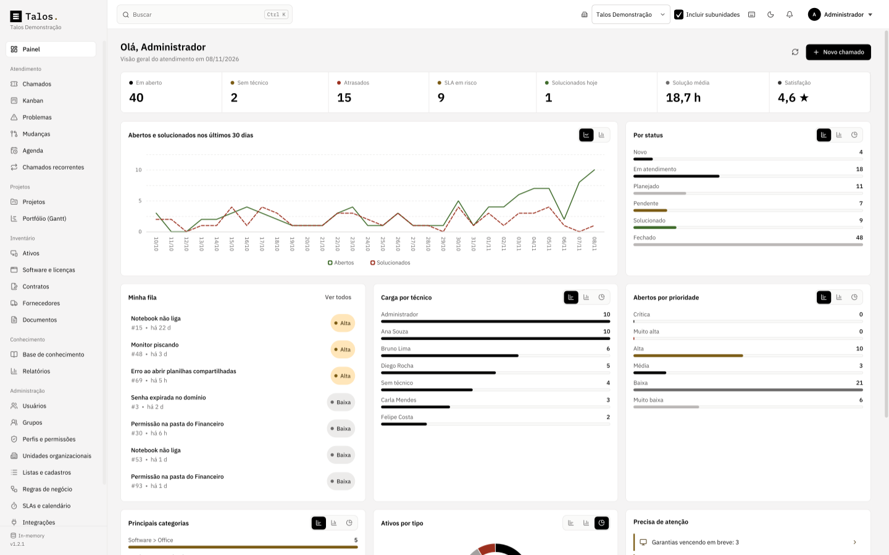
</p>

## O que o Talos faz

- **Chamados:** incidentes e requisições com urgência e impacto; a prioridade sai de uma matriz, como no GLPI, e a prioridade 6 (Crítica) é manual. Visões prontas (abertos, atribuídos a mim, meus grupos, sem técnico, atrasados, solucionados, fechados, lixeira), filtros por tipo, prioridade, categoria e técnico e exportação CSV.
- **SLA:** prazos de atendimento (TTO) e de solução (TTR) por prioridade, contados em horário comercial, com feriados e pausa enquanto o chamado está pendente. O prazo fica amarelo quando entra em risco e vermelho quando estoura, e os alertas são automáticos.
- **Linha do tempo:** acompanhamentos públicos ou privados, **respostas prontas** com os campos `{requester}`, `{reference}`, `{title}` e `{me}`, tarefas com tempo gasto e planejamento, solução com aceite ou recusa do requerente e pesquisa de satisfação de 1 a 5 estrelas.
- **Problemas e mudanças:** problemas com sintomas, causa raiz e impacto; mudanças com tipo, risco, plano de implantação, plano de retorno, checklist e fluxo de **aprovação** feito por outra pessoa.
- **Pessoas:** um ou mais responsáveis por item, seguidores que só acompanham, grupos observadores e vínculos entre chamados, problemas e mudanças (relacionado, duplica, causado por, depende de), ativos afetados e documentos.
- **Ações em lote (1.2.0):** selecione vários itens e atribua, mude o status, a urgência ou a categoria, escreva o mesmo acompanhamento, duplique, mescle ou mande para a lixeira de uma vez. Cada item passa pelas mesmas permissões da tela dele.
- **Mescla e duplicação (1.2.0):** junte chamados repetidos num item principal, com a descrição, os acompanhamentos, as tarefas, as pessoas e os ativos copiados, ou crie uma cópia nova de qualquer item.
- **Itens parecidos (1.2.0):** enquanto você digita o título de um item novo, até quatro itens abertos com título parecido aparecem como links, para evitar duplicados.
- **Novo item em segundos:** <kbd>Ctrl</kbd> + <kbd>N</kbd> abre um formulário enxuto (título, quadro, tipo, categoria, responsáveis, seguidores e descrição); o formulário completo fica a um clique.
- **Kanban:** quadros de chamados, problemas, mudanças e tarefas de projeto. Arraste o cartão para mudar o status; as colunas mostram itens, tempo trabalhado e atrasados, e os cartões mostram categoria colorida, tipo, responsáveis, prazo, bandeira de prioridade e tarefas.
- **Projetos:** Gantt com dependências, marcos, caminho crítico e reprogramação automática, Kanban das tarefas, membros, progresso calculado e portfólio com todos os projetos ativos.
- **Agenda:** semana das tarefas planejadas de cada técnico, com exportação dos prazos em **iCalendar** (`.ics`) para o Outlook, Google Agenda ou Apple Calendário.
- **Inventário:** computadores, notebooks, servidores, monitores, impressoras, rede, telefones, tablets e periféricos, com patrimônio, série, IP, MAC, garantia e responsáveis; conexões de rede, software instalado, licenças com conformidade, contratos com aviso prévio e renovação, fornecedores, documentos e importação e exportação CSV.
- **Base de conhecimento:** artigos em Markdown com categorias, rascunhos e FAQ, e a interface de **autoatendimento** para os usuários finais abrirem e acompanharem os próprios chamados.
- **Relatórios:** 13 relatórios com gráfico e tabela exportável em CSV: chamados por mês e por categoria, desempenho dos técnicos, cumprimento de SLA, **primeiro atendimento**, **idade dos chamados abertos**, **quem mais abre chamados**, satisfação, ativos por tipo e por localização, garantias e contratos a vencer e conformidade de licenças.
- **Regras de negócio:** critérios (título, conteúdo, tipo, urgência, impacto, prioridade, categoria, localização, requerente, grupo do requerente, unidade e origem) e ações (atribuir técnico ou grupo, definir categoria, localização, tipo, urgência, impacto, prioridade e SLAs, adicionar observador e pedir aprovação), com ordem, "parar processamento" e testador embutido. Chamados recorrentes e fechamento automático completam a automação.
- **Administração no estilo GLPI:** unidades organizacionais em hierarquia, perfis com permissões por módulo concedidos por unidade, grupos, listas configuráveis, SLAs, calendário e feriados, auditoria campo a campo, lixeira e configurações.
- **Integrações:** webhooks para Slack, Microsoft Teams, Discord, Google Chat e JSON genérico assinado com HMAC-SHA256, com botão de teste e registro das últimas entregas.
- **Interface:** temas claro e escuro, português e inglês, paleta de comandos (<kbd>Ctrl</kbd> + <kbd>K</kbd>), guia de atalhos (<kbd>F1</kbd>), zoom de 50% a 175%, animações suaves, gráficos em barras, colunas, linha ou rosca e **modo demonstração** sem banco.
- **Seguro por padrão:** sem senha padrão, PBKDF2 com 600 mil iterações, login sem pistas com atraso progressivo, sessão revalidada, permissões checadas no serviço, senha do banco protegida pela DPAPI do Windows e CSV sem fórmulas. Detalhes em [Qualidade e segurança](#qualidade-e-segurança).

## Ações em lote e mescla (1.2.0)

Na lista de **Chamados**, **Problemas** ou **Mudanças**, quem pode editar seleciona vários itens com Ctrl ou Shift + clique (ou <kbd>Ctrl</kbd> + <kbd>A</kbd> para a página inteira) e usa o botão **Ações em lote**, ao lado da exportação, ou o menu do botão direito.

| Ação | O que faz |
|---|---|
| Atribuir a mim / Atribuir… | Define o técnico e/ou o grupo responsáveis por todos os selecionados; o que ficar em branco é mantido (permissão Atribuir) |
| Alterar status | Move todos para o status escolhido, respeitando o fluxo; solucionar e fechar continuam exigindo uma solução |
| Urgência | Muda a urgência e recalcula a prioridade pela matriz |
| Alterar categoria… | Troca a categoria de todos |
| Adicionar acompanhamento… | Escreve o mesmo texto em todos, público ou como nota privada |
| Mesclar selecionados… | Você escolhe o item principal e os outros são copiados para ele e fechados como duplicados |
| Duplicar | Com um item selecionado, cria uma cópia nova e abre a tela dela |
| Mover para a lixeira / Restaurar | Exclui ou restaura todos (permissão Excluir) |

- **Item por item:** cada item é gravado separadamente, com as permissões e validações da tela do item. Se algum não puder ser alterado, os demais são gravados e uma janela lista o número e o motivo de cada falha. São até 500 itens por vez.
- **Mescla:** o item principal recebe a descrição de cada duplicado, os acompanhamentos (marcados com o número de origem e com o mesmo nível de privacidade), as tarefas e o tempo gasto (transferidos, sem contar duas vezes), o requerente, os seguidores, os grupos observadores e os ativos. O duplicado ganha um acompanhamento apontando para o principal, o vínculo **Duplica** e é fechado; mudanças são canceladas. Também dá para mesclar pela tela do item, no menu **⋯ → Mesclar em outro item…**, informando o número do principal.
- **Duplicar:** pelo menu **⋯ → Duplicar** da tela do item ou pelas ações em lote. A cópia começa como **Novo**, sem responsável, sem prazos nem histórico, e com um vínculo para o original; no autoatendimento, a cópia fica em nome de quem a criou.
- **Itens parecidos:** o formulário de novo item compara as palavras do título (sem diferenciar acentos nem palavras curtas) com os itens abertos e mostra os mais parecidos; um clique abre o item em vez de criar outro.

| Relatório novo | O que mostra |
|---|---|
| Primeiro atendimento | Chamados assumidos por mês, tempo médio até o primeiro atendimento e cumprimento do SLA de atendimento (TTO) |
| Idade dos chamados abertos | Chamados abertos agora por tempo de espera (até 1 dia, 1 a 3, 3 a 7, 7 a 30 e mais de 30 dias), com incidentes, requisições e atrasados |
| Quem mais abre chamados | Os 25 requerentes com mais chamados no período, quantos seguem abertos, incidentes e satisfação média |

| Correção | Antes | Agora |
|---|---|---|
| Busca no banco | "manutencao" não encontrava "Manutenção" fora do modo demonstração | A busca ignora acentos em todos os seis bancos |
| SLA em risco | Um SLA de horário comercial entrava em risco no fim de semana | O risco conta só as horas de atendimento |
| Aprovação de mudança | Uma recusa antiga travava a mudança para sempre | Vale a resposta mais recente de cada aprovador |
| Regras de negócio | Qualquer regra recalculava a prioridade, até a Crítica | A prioridade só é recalculada quando a regra muda urgência ou impacto; **não contém** com grupos funciona |
| Chamados recorrentes | Um modelo com erro travava todos os outros | Cada modelo roda separado, e o que falha avança para a próxima data |
| Projetos | Tarefas-mãe de vários níveis ficavam um nível atrasadas | O progresso e as datas sobem por todos os níveis |
| Segurança | Importação de ativos, troca de unidade, lixeira, exclusão de tarefas e pessoas do chamado tinham brechas de permissão | Todas checam permissão e visibilidade |
| CSV | Aspas no meio de um campo engoliam o resto do arquivo; 31/02 virava 28/02 | Aspas internas são preservadas e datas impossíveis são recusadas |

## Telas

| | |
|---|---|
| 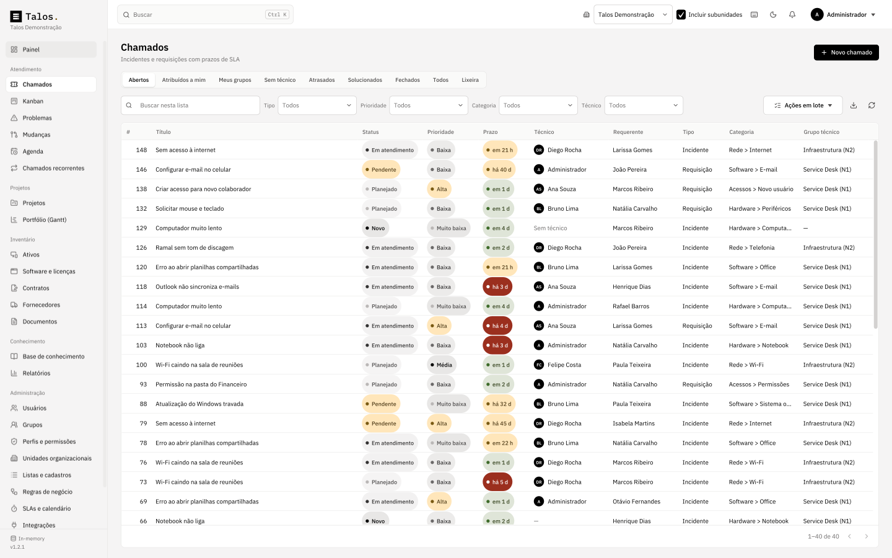 | 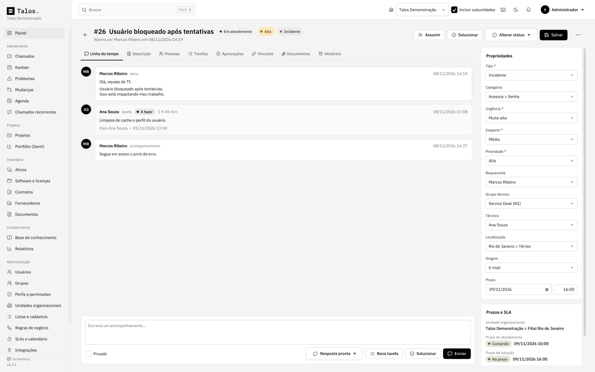 |
| **Chamados** com visões, prioridade e prazo de SLA | **Linha do tempo** do chamado, solução e propriedades |
| 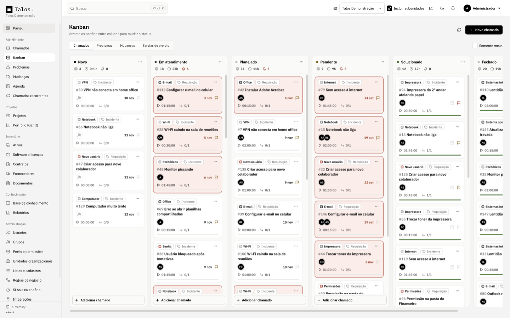 | 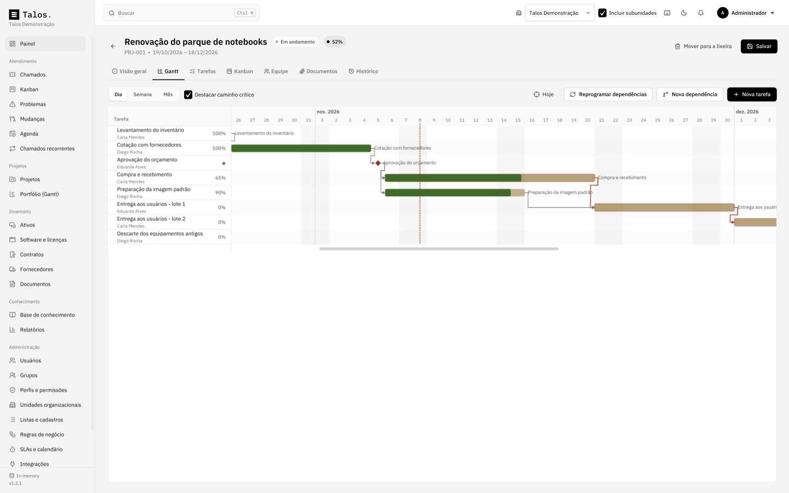 |
| **Kanban** com contadores, responsáveis e prazos | **Gantt** com dependências e caminho crítico |
| 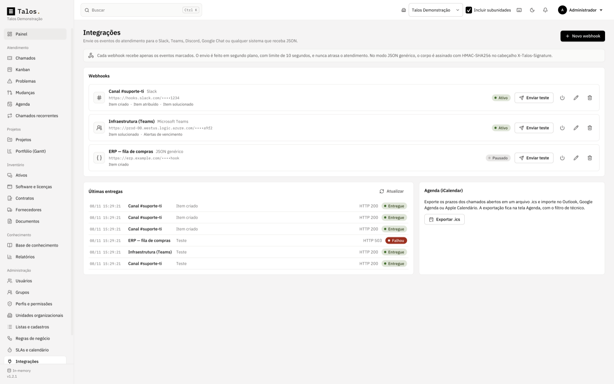 | 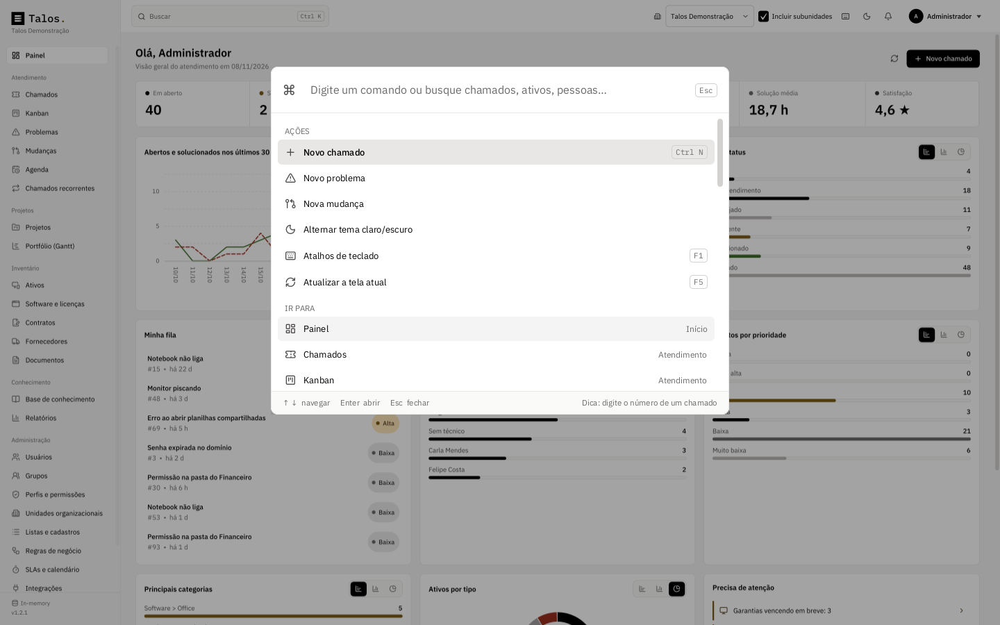 |
| **Integrações** com Slack, Teams, Discord e Google Chat | **Paleta de comandos** com busca e ações |
| 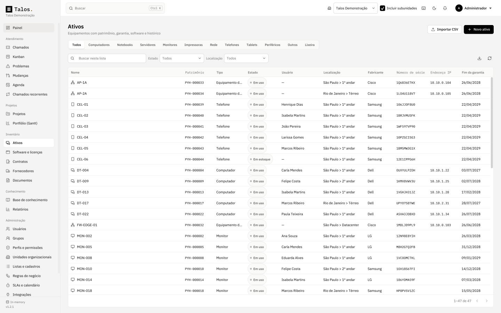 | 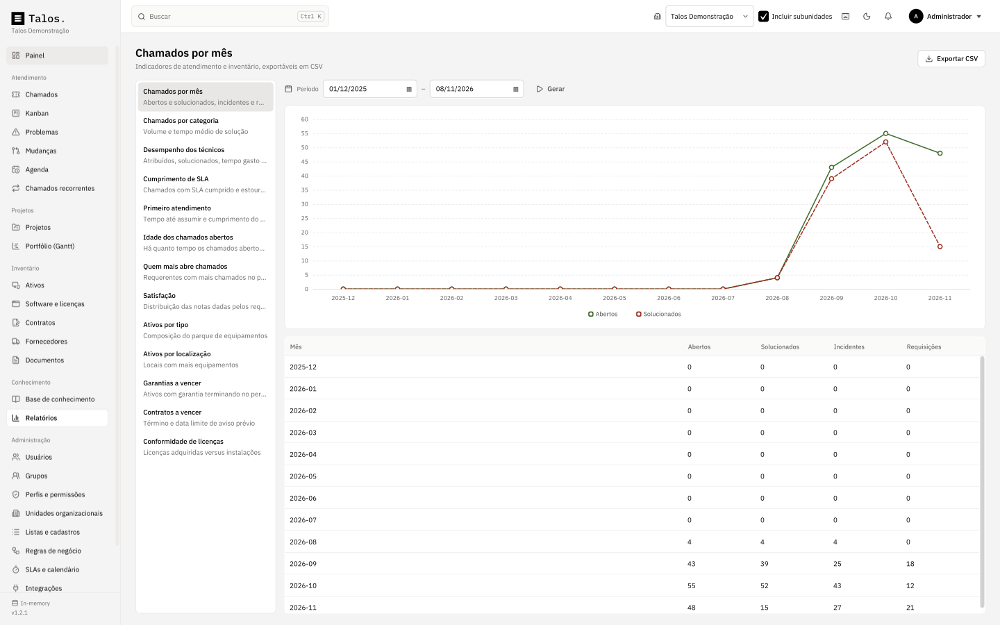 |
| **Inventário** de equipamentos | **Relatórios** exportáveis em CSV |
| 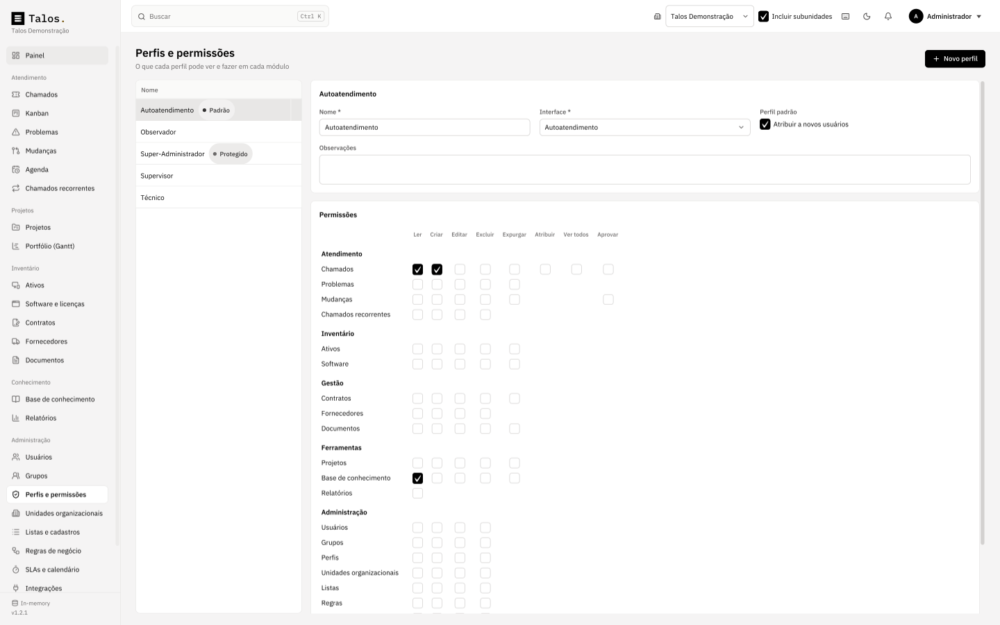 | 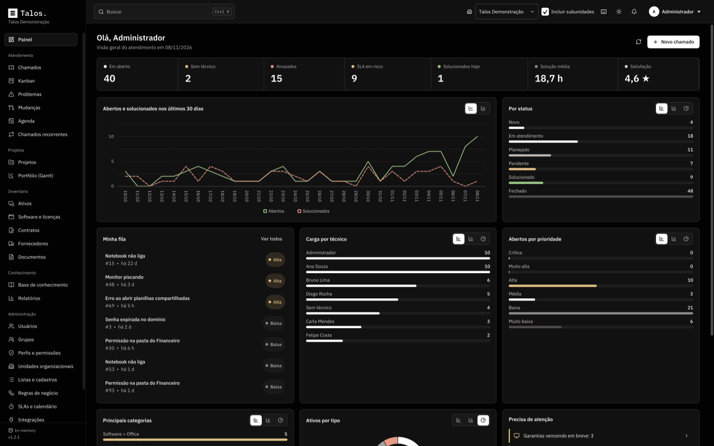 |
| **Perfis e permissões** por módulo | **Tema escuro** |

> As telas mostram os dados de demonstração gerados pelo próprio programa. Todos os nomes, e-mails e números são fictícios.

## Integrações (1.1.0)

Em **Administração › Integrações** você conecta o Talos às ferramentas que a equipe já usa. Cada webhook recebe só os eventos marcados, no momento em que acontecem. O envio é assíncrono (a tela nunca trava) e cada tentativa tem tempo limite de 10 segundos.

| Destino | O que chega |
|---|---|
| **Slack** | Mensagem no canal com número, título e status do item (Incoming Webhook) |
| **Microsoft Teams** | Cartão de mensagem no canal (webhook de entrada ou fluxo do Workflows) |
| **Discord** | Mensagem no canal (webhook do canal) |
| **Google Chat** | Mensagem no espaço (webhook do espaço) |
| **JSON genérico** | POST com o evento completo, para n8n, Power Automate, Zapier ou sistemas próprios |

**Eventos:** item criado, atribuído, com status alterado ou solucionado (chamados, problemas e mudanças) e alertas de vencimento de garantias, contratos e licenças.

### Conectar o Slack ou o Teams

1. No **Slack**, crie um *Incoming Webhook* para o canal. No **Teams**, crie um webhook de entrada (ou um fluxo do Workflows que recebe solicitações HTTP). Copie a URL.
2. No Talos, abra **Administração › Integrações** e clique em **Novo webhook**.
3. Dê um nome, escolha o destino, cole a URL e marque os eventos.
4. Clique em **Enviar teste**: a mensagem chega no canal e o resultado (status HTTP e horário) aparece em **Últimas entregas**.
5. Salve. O botão de pausa (ou a opção **Ativo**) suspende o webhook sem apagar a configuração.

### Webhook JSON genérico

```json
{
  "event": "item.solved",
  "occurredAt": "2026-10-27T14:32:05-03:00",
  "organization": "Acme Ltda.",
  "item": {
    "type": "Ticket",
    "id": 125,
    "reference": "#125",
    "title": "Outlook não sincroniza e-mails",
    "status": "SOLVED",
    "priority": 4
  },
  "actor": "Ana Souza",
  "detail": null,
  "text": "Chamado #125 — solucionado — Outlook não sincroniza e-mails"
}
```

Códigos de evento: `item.created`, `item.assigned`, `item.status_changed`, `item.solved`, `inventory.expiration_alert` e `integration.test` (botão **Enviar teste**). O código também vai no cabeçalho `X-Talos-Event`.

Se você informar um **segredo**, cada envio leva o cabeçalho `X-Talos-Signature: sha256=<hex>` com o HMAC-SHA256 do corpo. Confira no sistema que recebe:

```python
import hashlib, hmac

def assinatura_valida(corpo: bytes, cabecalho: str, segredo: str) -> bool:
    esperado = "sha256=" + hmac.new(segredo.encode(), corpo, hashlib.sha256).hexdigest()
    return hmac.compare_digest(esperado, cabecalho)
```

> Use sempre URLs `https://` e trate a URL do webhook como senha: quem a tiver pode publicar no canal.

- **Calendário:** Agenda › **Exportar .ics** gera um arquivo iCalendar com os prazos dos chamados abertos.
- **Planilhas:** qualquer lista exporta para CSV (com proteção contra fórmulas), e o inventário de ativos importa CSV com modelo pronto.
- **Banco de dados:** o modelo completo está em [docs/banco-de-dados.md](docs/banco-de-dados.md), para relatórios em Power BI, Metabase ou Looker Studio direto no servidor.

## Atalhos de teclado

| Atalho | Ação |
|---|---|
| <kbd>Ctrl</kbd> + <kbd>K</kbd> | Paleta de comandos: busca global e ações rápidas |
| <kbd>Ctrl</kbd> + <kbd>N</kbd> | Novo chamado |
| <kbd>Ctrl</kbd> + <kbd>Shift</kbd> + <kbd>N</kbd> | Ir para Chamados |
| <kbd>F1</kbd> | Guia de atalhos |
| <kbd>F5</kbd> | Atualizar a tela atual |
| <kbd>Esc</kbd> | Fechar janelas, menus e a paleta |
| <kbd>Ctrl</kbd> + <kbd>A</kbd> numa lista | Selecionar a página inteira para as ações em lote |
| Ctrl ou Shift + clique, <kbd>Shift</kbd> + <kbd>↑</kbd> / <kbd>↓</kbd> | Selecionar vários itens |
| <kbd>Enter</kbd> numa tabela | Abrir o item selecionado |
| <kbd>Ctrl</kbd> + rolagem do mouse | Ampliar ou reduzir a interface |
| <kbd>Ctrl</kbd> + <kbd>+</kbd> / <kbd>-</kbd> / <kbd>0</kbd> | Ampliar / reduzir / voltar ao zoom padrão (75%) |

## Arquitetura

O projeto segue uma **arquitetura hexagonal** (portas e adaptadores). As regras de negócio não conhecem Spring, JPA nem JavaFX; o banco e a interface são adaptadores trocáveis.

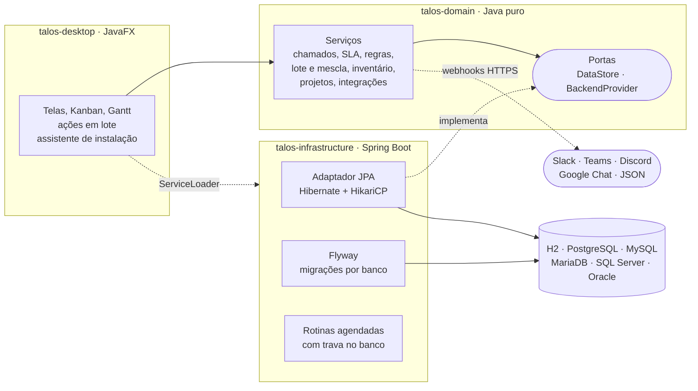

| Módulo | Responsabilidade |
|---|---|
| `talos-domain` | Entidades, serviços, matriz de prioridade, calendário comercial, motor de regras, agendamento de projetos (caminho crítico), permissões, auditoria, ações em lote, mescla e integrações (webhooks com `java.net.http`, sem dependências extras). Inclui um repositório em memória usado nos testes e no modo demonstração. |
| `talos-infrastructure` | Contexto Spring Boot sem servidor web (`web-application-type=none`), Spring Data JPA/Hibernate, Flyway com scripts para cada banco, drivers JDBC e as rotinas periódicas. |
| `talos-desktop` | Interface JavaFX, paleta de comandos, atalhos, ações em lote, assistente de primeiro uso, configuração local e criptografia da senha do banco. Encontra o backend pelo `ServiceLoader`. |

### O que vem do GLPI

O Talos não usa código do GLPI; ele reaproveita os **conceitos** que tornaram o GLPI uma referência:

| GLPI | Talos |
|---|---|
| Entidades | Unidades organizacionais com herança para subunidades |
| Perfis e direitos | Perfis com permissões por módulo, concedidos por unidade |
| Objetos ITIL (Ticket, Problem, Change) | Mesma base comum (`ItilItem`) com status, urgência, impacto e prioridade |
| Acompanhamentos, tarefas, soluções e validações | Linha do tempo com os mesmos tipos de evento |
| Ações em massa e mesclagem de chamados | Ações em lote e mescla com vínculo **Duplica** |
| Regras de negócio para chamados | Critérios e ações com ordem e "parar processamento" |
| SLA e calendários | TTO e TTR em horário comercial com feriados |
| Dropdowns | Listas configuráveis e hierárquicas |
| Ações automáticas (cron) | Rotinas coordenadas pelo banco entre várias estações |
| Lixeira e histórico | Exclusão reversível e auditoria campo a campo |

## Como rodar

### 1. Instalador (Talos-1.2.1.exe)

1. Baixe o [**Talos-1.2.1.exe**](https://github.com/ravelroot/Information-Technology-Service-Management/raw/main/Talos-1.2.1.exe), que fica na raiz deste repositório.
2. Execute, escolha a pasta de instalação e conclua.
3. Abra o **Talos** pelo menu Iniciar ou pelo atalho na área de trabalho.

<details>
<summary>Baixar e abrir o instalador pelo PowerShell</summary>

```powershell
$ProgressPreference='SilentlyContinue'; [Net.ServicePointManager]::SecurityProtocol='Tls12'; $f="$env:TEMP\Talos-1.2.1.exe"; Invoke-WebRequest 'https://github.com/ravelroot/Information-Technology-Service-Management/raw/main/Talos-1.2.1.exe' -OutFile $f -UseBasicParsing; Start-Process $f
```
</details>

O instalador já inclui o Java e todas as bibliotecas. Quem usa a 1.0.0, a 1.1.0 ou a 1.2.0 pode instalar por cima: banco, configurações e conexão são mantidos. Ao desinstalar (Configurações › Aplicativos), o Talos apaga também o que guardou no computador: configurações, logs e o banco local H2. Bancos em servidor não são tocados.

| | Mínimo |
|---|---|
| Sistema | Windows 10 ou 11, 64 bits |
| Memória | 4 GB (o programa usa até 1 GB) |
| Disco | 400 MB para o programa, mais o espaço do banco |
| Banco | H2 embutido, ou um servidor da lista em [Banco de dados](#banco-de-dados) |
| Rede (opcional) | Saída HTTPS para os webhooks das integrações |

### 2. Primeiro uso

Na primeira vez que o programa abre, um assistente de quatro passos aparece:

1. **Banco de dados:** escolha onde os dados ficarão e clique em *Testar conexão*. As tabelas são criadas automaticamente.
2. **Organização e administrador:** dê um nome à organização e crie a conta de administrador com a sua própria senha. **Não existe usuário ou senha padrão.**
3. **Entrar:** use o login e a senha que você acabou de criar.
4. **Configuração inicial:** telas guiadas para cadastrar a base da organização. Cada item é gravado no banco assim que você salva.

| Etapa | Obrigatória | O que você cadastra |
|---|:-:|---|
| Organização | sim | Nome e e-mail de contato (telefone e endereço opcionais) |
| Unidades | | Filiais e departamentos |
| Localizações | sim | Pelo menos um prédio, andar ou sala |
| Equipe | sim | Pelo menos um grupo técnico; técnicos podem ser adicionados agora ou depois |
| Horário | sim | Dias e horário de atendimento usados pelo SLA |
| Categorias | | Categorias de chamado além das que já vêm prontas |

<p align="center">
  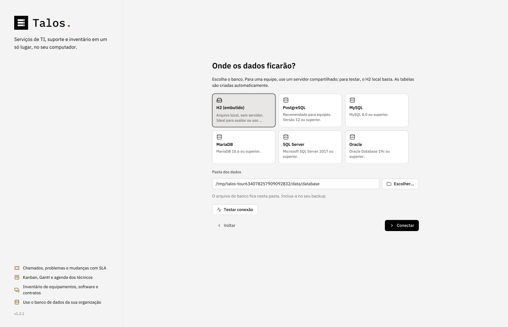
</p>

Depois disso, chamados, ativos, contratos, projetos e artigos começam **vazios**. Perfis, SLAs por prioridade, feriados nacionais, listas comuns e quatro respostas prontas já vêm criados. Cadastre as pessoas em **Administração › Usuários** e dê a cada uma um perfil:

| Perfil | Para quem |
|---|---|
| Super-Administrador | Configura tudo, inclusive as integrações. Perfil protegido. |
| Supervisor | Coordena a equipe: vê e atribui todos os chamados, aprova mudanças, vê relatórios. |
| Técnico | Atende chamados, usa as ações em lote, cuida do inventário e dos projetos. |
| Observador | Apenas consulta. |
| Autoatendimento | Usuários finais: abrem e acompanham os próprios chamados e leem o FAQ. |

Cada computador da equipe instala o Talos e aponta para o **mesmo servidor de banco**. Notificações, alertas de SLA, webhooks e rotinas automáticas são coordenados entre as estações pelo próprio banco.

### 3. Compilar a partir do código

```bat
git clone https://github.com/ravelroot/Information-Technology-Service-Management.git
cd Information-Technology-Service-Management
scripts\build-windows.cmd
```

O script procura um **JDK 21** e o **Maven** (ou baixa versões portáteis para `.tools`, sem instalar nada no sistema), baixa o **WiX Toolset 3** usado pelo `jpackage`, roda `mvn clean verify` e gera o `Talos-1.2.1.exe` na raiz do projeto. Use `scripts\build-windows.cmd -SkipTests` para compilar mais rápido; o log completo fica em `build-logs\`.

Manualmente, com JDK 21+ e Maven 3.9+:

```bash
mvn clean verify
java -jar talos-desktop/target/app/talos.jar
```

A pasta `talos-desktop/target/app` contém o `talos.jar` e todas as dependências; é dela que o `jpackage` monta o instalador. Publicar uma tag `v*` dispara o workflow `release.yml`, que gera o instalador no Windows e o anexa à versão.

O manual em PDF é gerado a partir do texto em `scripts/manual/content.py`, com os prints da classe de teste `ScreenshotTour`:

```bash
pip install reportlab
python3 scripts/manual/build_manual.py --images <pasta-dos-prints> --out "Manual-Talos-Versão 1.2.1.pdf"
```

## Banco de dados

O banco é escolha sua. O Talos traz os drivers e os scripts de criação para todos estes:

| Banco | Versão mínima | Indicado para |
|---|---|---|
| **H2** (embutido) | já incluso | Avaliação ou uso em um único computador |
| **PostgreSQL** | 12 | Equipes (recomendado) |
| **MySQL** | 8.0 | Equipes |
| **MariaDB** | 10.6 | Equipes |
| **Microsoft SQL Server** | 2017 | Equipes que já usam SQL Server |
| **Oracle Database** | 19c | Equipes que já usam Oracle |

O modelo completo (tabelas, campos, relacionamentos, valores aceitos e tipos em cada banco) está em [**docs/banco-de-dados.md**](docs/banco-de-dados.md). A estrutura é versionada com **Flyway**: ao atualizar o Talos, as novas migrações são aplicadas sozinhas na primeira conexão. A 1.2.0 não cria tabelas nem colunas: a mescla usa as tabelas de vínculos, acompanhamentos, tarefas, observadores e ativos que já existiam. A 1.2.1 também não: muda só o visual.

Para um servidor, crie antes um banco vazio e um usuário com permissão para criar tabelas (troque o nome e **use uma senha forte sua**):

<details>
<summary>PostgreSQL</summary>

```sql
CREATE USER talos WITH PASSWORD 'troque-esta-senha';
CREATE DATABASE talos OWNER talos ENCODING 'UTF8';
```
</details>

<details>
<summary>MySQL / MariaDB</summary>

```sql
CREATE DATABASE talos CHARACTER SET utf8mb4 COLLATE utf8mb4_unicode_ci;
CREATE USER 'talos'@'%' IDENTIFIED BY 'troque-esta-senha';
GRANT ALL PRIVILEGES ON talos.* TO 'talos'@'%';
```
</details>

<details>
<summary>SQL Server</summary>

```sql
CREATE DATABASE talos;
GO
CREATE LOGIN talos WITH PASSWORD = 'troque-esta-senha';
GO
USE talos;
CREATE USER talos FOR LOGIN talos;
ALTER ROLE db_owner ADD MEMBER talos;
```
O Talos valida o certificado do servidor. Se o seu SQL Server usa um certificado próprio (autoassinado), informe em *Parâmetros extras*: `trustServerCertificate=true`.
</details>

<details>
<summary>Oracle</summary>

```sql
CREATE USER talos IDENTIFIED BY "troque-esta-senha" QUOTA UNLIMITED ON USERS;
GRANT CREATE SESSION, CREATE TABLE, CREATE SEQUENCE TO talos;
```
No campo *Banco*, informe o nome do serviço (por exemplo `FREEPDB1`).
</details>

Em *Parâmetros extras* você pode acrescentar opções do driver (por exemplo `ssl=true` no PostgreSQL) ou colar uma URL JDBC completa começando por `jdbc:`.

## Configuração

| O quê | Onde |
|---|---|
| Configuração da conexão, idioma, tema, zoom e janela | `%APPDATA%\Talos\talos.properties` (a senha do banco é criptografada com a DPAPI do Windows) |
| Banco H2 embutido | `%LOCALAPPDATA%\Talos\database` (ou a pasta que você escolher) |
| Logs | `%LOCALAPPDATA%\Talos\logs\talos.log` |
| Programa | `Arquivos de Programas\Talos`, com o Java embutido |

Nada é gravado na pasta de instalação. Para trocar de banco, use **Configurações › Banco de dados** ou o link *Usar outro banco de dados* na tela de login. As configurações da organização (SLA, fechamento automático, pesquisa de satisfação, bloqueio de login, sessão, integrações) ficam no banco, em **Administração › Configurações**.

## Desenvolvimento e testes

```bash
mvn verify
```

- **Domínio:** ciclo de vida dos chamados, SLA em horário comercial, matriz de prioridade, motor de regras, caminho crítico, permissões, segurança, CSV, integrações, dados de demonstração, ações em lote, mescla, duplicação, itens parecidos, novos relatórios e as correções da 1.2.0.
- **Infraestrutura:** inicialização real do Spring Boot com H2, migrações Flyway, bloqueio otimista, busca sem acentos no banco e verificação de que os scripts SQL de todos os bancos correspondem às entidades.
- **Interface:** traduções completas e iguais em português e inglês.

Para testar contra servidores reais (requer Docker):

```bash
mvn -pl talos-infrastructure -am verify -Dtest=DatabaseCompatibilityTest -Dsurefire.failIfNoSpecifiedTests=false \
    -Dtalos.databases=postgresql,mysql,mariadb,sqlserver,oracle
```

O workflow `ci.yml` roda os testes a cada envio e todos os dias, e a compatibilidade com os cinco bancos em Docker. Sugestões e correções são bem-vindas: veja o [CONTRIBUTING.md](CONTRIBUTING.md) para preparar o ambiente, as convenções do código e como adicionar uma migração de banco ou um texto traduzido.

## Qualidade e segurança

- **Sem senha padrão:** a conta de administrador é criada no primeiro uso, com a senha que você definir.
- **Senhas:** PBKDF2-HMAC-SHA256 com 600 mil iterações e salt aleatório; hashes antigos são atualizados sozinhos no próximo login. Política de 10 a 128 caracteres, com letras e números, sem conter o login ou o nome e fora de uma lista de senhas comuns.
- **Login sem pistas:** usuário inexistente, senha errada e conta bloqueada recebem a mesma resposta, com o mesmo tempo de verificação e um atraso a cada falha. Bloqueio após 3 a 10 tentativas, por 5 a 1440 minutos.
- **Sessão:** encerrada após inatividade (padrão 15 minutos) e revalidada a cada 30 segundos; se a conta for desativada, bloqueada ou perder o perfil, o acesso cai na hora.
- **Permissões no serviço:** verificadas na camada de serviço, e não só escondendo botões, inclusive em cada item das ações em lote e da mescla. Ninguém concede perfis maiores que os seus, altera o próprio acesso ou mexe num Super-Administrador sem ser um; sempre resta um Super-Administrador ativo; aprovações são feitas por outra pessoa.
- **Visibilidade (1.2.0):** salvar um item não troca a unidade para uma que você não vê nem o envia para a lixeira sem a permissão Excluir; a importação CSV de ativos só altera ativos visíveis e com permissão de edição; excluir tarefas respeita a visibilidade do item; seguidores do autoatendimento não alteram as pessoas do chamado de outra pessoa.
- **Dados e arquivos:** a senha do banco é criptografada com a DPAPI do Windows; links de documentos só aceitam `http(s)`, e-mail ou arquivos não executáveis e pedem confirmação; exportações CSV neutralizam fórmulas; expressões regulares das regras têm tamanho e tempo limitados; SQL Server com validação de certificado; H2 sem porta de rede; Flyway protegido contra limpeza acidental; erros inesperados mostram uma mensagem genérica e os detalhes ficam só no log local; a JVM instalada bloqueia a anexação de ferramentas externas.
- **Integrações:** só quem edita as configurações cria webhooks; envio assíncrono com tempo limite de 10 segundos; assinatura HMAC-SHA256 opcional; as mensagens levam só número, título, status, prioridade e o nome de quem agiu.
- **Repositório:** nenhuma conexão, senha, chave ou banco de exemplo versionado; os dados de demonstração são gerados na hora, com nomes e e-mails fictícios (`@example.com`) e usuários sem senha. Encontrou uma vulnerabilidade? Veja o [SECURITY.md](SECURITY.md).

### Estrutura

```
Information-Technology-Service-Management/
├── Talos-1.2.1.exe             instalador para Windows
├── Manual-Talos-Versão 1.2.1.pdf
├── talos-domain/               regras de negócio (sem framework)
├── talos-infrastructure/       Spring Boot, JPA, Flyway, drivers
│   └── src/main/resources/db/migration/{h2,postgresql,mysql,sqlserver,oracle}
├── talos-desktop/              interface JavaFX
│   └── src/main/resources/io/talos/desktop/{css,i18n,icons,fonts,images}
├── packaging/windows/          ícone, imagens e limpeza do instalador
├── scripts/                    build-windows.cmd, build-windows.ps1, StoreJars.java
│   └── manual/                 gerador do manual em PDF (ReportLab)
├── docs/
│   ├── banco-de-dados.md       modelo do banco
│   ├── manual/                 cópia do manual em PDF
│   └── images/                 logo, banners e telas deste README
└── .github/workflows/          CI, publicação de versões e atividade diária
```

### Componentes de terceiros

| Componente | Uso no projeto | Licença |
|---|---|---|
| [Eclipse Temurin / OpenJDK](https://adoptium.net) | Java embutido no instalador (`jlink`) | GPL-2.0 com Classpath Exception |
| [OpenJFX](https://openjfx.io) | Interface | GPL-2.0 com Classpath Exception |
| [Spring Boot](https://spring.io/projects/spring-boot) e Spring Framework | Backend, injeção de dependências e rotinas | Apache-2.0 |
| [Hibernate ORM](https://hibernate.org) | JPA | Apache-2.0 |
| [HikariCP](https://github.com/brettwooldridge/HikariCP) | Pool de conexões | Apache-2.0 |
| [Flyway](https://github.com/flyway/flyway) Community | Migrações do banco | Apache-2.0 |
| [H2 Database](https://h2database.com) | Banco embutido | MPL-2.0 / EPL-1.0 |
| Drivers JDBC do [PostgreSQL](https://jdbc.postgresql.org), [MySQL](https://dev.mysql.com/downloads/connector/j/), [MariaDB](https://mariadb.com/kb/en/about-mariadb-connector-j/), [SQL Server](https://github.com/microsoft/mssql-jdbc) e [Oracle](https://www.oracle.com/database/technologies/appdev/jdbc.html) | Conexão com os servidores | BSD-2-Clause, GPL-2.0 com FOSS Exception, LGPL-2.1, MIT e Oracle FUTC |
| [JNA](https://github.com/java-native-access/jna) | DPAPI do Windows | Apache-2.0 / LGPL-2.1 |
| [Logback](https://logback.qos.ch) e [SLF4J](https://www.slf4j.org) | Logs | EPL-1.0 / LGPL-2.1 e MIT |
| [Lucide](https://lucide.dev) | Ícones | ISC |
| [IBM Plex Sans e Plex Mono](https://github.com/IBM/plex) | Fontes | SIL Open Font License 1.1 |
| [ReportLab](https://www.reportlab.com) | Geração do manual em PDF | BSD |

A arquitetura é inspirada no [GLPI](https://glpi-project.org), da Teclib'. O Talos é um projeto independente, sem relação com o GLPI ou a Teclib', e não usa código do GLPI. Detalhes em [THIRD-PARTY-NOTICES.md](THIRD-PARTY-NOTICES.md).

## Licença

Copyright (©) 2026 Erik Pimenta

Este projeto é distribuído sob a licença [MIT](LICENSE). Você pode usar, copiar, modificar e redistribuir o código, inclusive para fins comerciais, desde que mantenha o aviso de copyright e o texto da licença.
