# Modelo do banco de dados

Este documento descreve o banco de dados do **Pyhoma.**: quais bancos são aceitos, como preparar cada um e todas as tabelas e campos que a aplicação usa. Ele é gerado a partir das migrações em [`pyhoma-infrastructure/src/main/resources/db/migration`](../pyhoma-infrastructure/src/main/resources/db/migration), que são a fonte oficial do esquema.

> **Você não cria as tabelas.** Ao conectar pela primeira vez, o Pyhoma. cria todas elas sozinho (Flyway) e, nas próximas versões, aplica as alterações automaticamente. Basta entregar um banco **vazio** e um usuário com permissão para criar tabelas.

## Bancos aceitos

| Banco | Versão mínima | Script do esquema | Observação |
|---|---|---|---|
| H2 (arquivo local) | 2.x | [`h2/V1__baseline.sql`](../pyhoma-infrastructure/src/main/resources/db/migration/h2/V1__baseline.sql) | Só para um computador. Fica em `%LOCALAPPDATA%\Pyhoma\database`. |
| PostgreSQL | 12 | [`postgresql/V1__baseline.sql`](../pyhoma-infrastructure/src/main/resources/db/migration/postgresql/V1__baseline.sql) | Recomendado para equipes. |
| MySQL / MariaDB | 8.0 / 10.6 | [`mysql/V1__baseline.sql`](../pyhoma-infrastructure/src/main/resources/db/migration/mysql/V1__baseline.sql) | Use `utf8mb4`. |
| SQL Server | 2017 | [`sqlserver/V1__baseline.sql`](../pyhoma-infrastructure/src/main/resources/db/migration/sqlserver/V1__baseline.sql) | Conexão criptografada; certificado autoassinado exige `trustServerCertificate=true`. |
| Oracle | 19c | [`oracle/V1__baseline.sql`](../pyhoma-infrastructure/src/main/resources/db/migration/oracle/V1__baseline.sql) | Use um esquema (usuário) só para o Pyhoma. |

Os cinco scripts criam exatamente as mesmas tabelas, colunas e índices; muda só a sintaxe de cada banco.

## Como preparar o banco

Crie um banco vazio e um usuário dono dele. Troque `troque-esta-senha` por uma senha forte e guarde-a: ela é informada uma única vez no assistente do Pyhoma. e fica criptografada no computador.

**PostgreSQL**

```sql
CREATE USER pyhoma WITH PASSWORD 'troque-esta-senha';
CREATE DATABASE pyhoma OWNER pyhoma ENCODING 'UTF8';
```

**MySQL / MariaDB**

```sql
CREATE DATABASE pyhoma CHARACTER SET utf8mb4 COLLATE utf8mb4_unicode_ci;
CREATE USER 'pyhoma'@'%' IDENTIFIED BY 'troque-esta-senha';
GRANT ALL PRIVILEGES ON pyhoma.* TO 'pyhoma'@'%';
```

**SQL Server**

```sql
CREATE DATABASE pyhoma;
GO
CREATE LOGIN pyhoma WITH PASSWORD = 'troque-esta-senha';
GO
USE pyhoma;
CREATE USER pyhoma FOR LOGIN pyhoma;
ALTER ROLE db_owner ADD MEMBER pyhoma;
GO
```

**Oracle**

```sql
CREATE USER pyhoma IDENTIFIED BY "troque-esta-senha" QUOTA UNLIMITED ON USERS;
GRANT CREATE SESSION, CREATE TABLE, CREATE SEQUENCE TO pyhoma;
```

Depois, no assistente do Pyhoma., escolha o banco, informe servidor, porta, nome do banco, usuário e senha e clique em **Testar conexão**. Todos os computadores da equipe apontam para o mesmo banco.

## Convenções

- Todas as tabelas começam com `pyh_`. O histórico das migrações fica em `pyh_schema_history`.
- Toda tabela tem as colunas-padrão abaixo, além dos campos próprios:

  | Coluna | Tipo | Uso |
  |---|---|---|
  | `id` | BIGINT, identidade | Chave primária gerada pelo banco |
  | `version` | BIGINT | Controle de edição simultânea (trava otimista) |
  | `created_at` | TIMESTAMP | Quando o registro foi criado |
  | `updated_at` | TIMESTAMP | Última alteração |

- Os relacionamentos usam colunas `*_id` que guardam o `id` de outra tabela. A integridade é garantida pela aplicação (não há `FOREIGN KEY`), o que permite lixeira, restauração e auditoria sem bloqueios entre tabelas.
- Itens que podem ir para a lixeira têm `deleted` (exclusão lógica). A exclusão definitiva só acontece pela ação **Excluir permanentemente**.
- Campos de lista fixa (status, tipo, risco...) são texto com o nome do valor, por exemplo `ASSIGNED`. Os valores aceitos estão em cada tabela abaixo.
- Listas editáveis pelo usuário (localizações, categorias, modelos, fabricantes...) ficam todas em `pyh_dropdown`, separadas pela coluna `kind`.
- `org_unit_id` define a unidade dona do registro e controla quem pode vê-lo.
- Datas e horas são gravadas sem fuso, no horário do computador que fez a alteração.

### Tipos em cada banco

| Modelo (PostgreSQL) | H2 | MySQL / MariaDB | SQL Server | Oracle |
|---|---|---|---|---|
| `BIGINT IDENTITY` | `BIGINT IDENTITY` | `BIGINT AUTO_INCREMENT` | `BIGINT IDENTITY(1,1)` | `NUMBER(19) IDENTITY` |
| `VARCHAR(n)` | `VARCHAR(n)` | `VARCHAR(n)` | `NVARCHAR(n)` | `VARCHAR2(n CHAR)` |
| `TEXT` | `CLOB` | `LONGTEXT` | `NVARCHAR(MAX)` | `CLOB` |
| `TIMESTAMP` | `TIMESTAMP` | `DATETIME(6)` | `DATETIME2` | `TIMESTAMP` |
| `DATE` | `DATE` | `DATE` | `DATE` | `DATE` |
| `BOOLEAN` | `BOOLEAN` | `BOOLEAN` | `BIT` | `NUMBER(1)` |
| `INTEGER` | `INTEGER` | `INTEGER` | `INT` | `NUMBER(10)` |
| `DECIMAL(15,2)` | `DECIMAL(15,2)` | `DECIMAL(15,2)` | `DECIMAL(15,2)` | `NUMBER(15,2)` |

## Visão geral dos relacionamentos

O diagrama mostra as ligações principais (as colunas-padrão foram omitidas).

```mermaid
erDiagram
    pyh_org_unit ||--o{ pyh_org_unit : "subunidades"
    pyh_org_unit ||--o{ pyh_ticket : "dona"
    pyh_org_unit ||--o{ pyh_asset : "dona"
    pyh_user ||--o{ pyh_profile_assignment : "habilitações"
    pyh_profile ||--o{ pyh_profile_assignment : "concedido em"
    pyh_org_unit ||--o{ pyh_profile_assignment : "vale para"
    pyh_profile ||--o{ pyh_profile_right : "permissões"
    pyh_group ||--o{ pyh_group_member : "membros"
    pyh_user ||--o{ pyh_group_member : "participa"
    pyh_user ||--o{ pyh_ticket : "requerente / técnico"
    pyh_group ||--o{ pyh_ticket : "grupo técnico"
    pyh_sla ||--o{ pyh_ticket : "TTO / TTR"
    pyh_ticket ||--o{ pyh_itil_followup : "linha do tempo"
    pyh_ticket ||--o{ pyh_itil_task : "tarefas"
    pyh_ticket ||--o{ pyh_itil_solution : "soluções"
    pyh_ticket ||--o{ pyh_itil_approval : "aprovações"
    pyh_ticket ||--o{ pyh_itil_asset : "ativos envolvidos"
    pyh_asset ||--o{ pyh_itil_asset : "envolvido em"
    pyh_recurring_ticket ||--o{ pyh_ticket : "gera"
    pyh_asset ||--o{ pyh_software_install : "instalações"
    pyh_software ||--o{ pyh_software_install : "instalado em"
    pyh_software ||--o{ pyh_software_license : "licenças"
    pyh_software_license ||--o{ pyh_software_install : "consome"
    pyh_supplier ||--o{ pyh_contract : "fornece"
    pyh_contract ||--o{ pyh_contract_item : "cobre"
    pyh_asset ||--o{ pyh_contract_item : "coberto por"
    pyh_document ||--o{ pyh_document_link : "anexado a"
    pyh_project ||--o{ pyh_project_task : "tarefas"
    pyh_project_task ||--o{ pyh_project_dependency : "depende de"
    pyh_project ||--o{ pyh_project_member : "equipe"
    pyh_rule ||--o{ pyh_rule_criterion : "SE"
    pyh_rule ||--o{ pyh_rule_action : "ENTÃO"
    pyh_dropdown ||--o{ pyh_asset : "local, modelo, estado"
```



Chamados, problemas e mudanças compartilham as tabelas `pyh_itil_*`: a coluna `item_type` diz de qual deles se trata (`TICKET`, `PROBLEM` ou `CHANGE`) e `item_id` guarda o `id`.

## Tabelas

### Organização, pessoas e acesso

#### `pyh_org_unit`

Unidades organizacionais em árvore (empresa, filial, departamento). Quase todo registro pertence a uma unidade.

| Coluna | Tipo | Obrigatória | Referência / valores |
|---|---|:-:|---|
| `name` | VARCHAR(150) | sim |  |
| `parent_id` | BIGINT |  | → `pyh_org_unit.id` (hierarquia) |
| `complete_name` | VARCHAR(600) |  | caminho completo, ex.: `Rio > Térreo` |
| `depth` | INTEGER | sim |  |
| `email` | VARCHAR(150) |  |  |
| `phone` | VARCHAR(60) |  |  |
| `address` | VARCHAR(300) |  |  |
| `notes` | TEXT |  |  |

Índices: `parent_id`.

#### `pyh_user`

Pessoas que entram no sistema. A senha é guardada só como hash.

| Coluna | Tipo | Obrigatória | Referência / valores |
|---|---|:-:|---|
| `login` | VARCHAR(80) | sim |  |
| `full_name` | VARCHAR(150) | sim |  |
| `email` | VARCHAR(150) |  |  |
| `phone` | VARCHAR(60) |  |  |
| `job_title` | VARCHAR(120) |  |  |
| `password_hash` | VARCHAR(255) |  | PBKDF2 (`pbkdf2$iterações$sal$hash`), nunca a senha |
| `active` | BOOLEAN | sim |  |
| `language` | VARCHAR(10) |  |  |
| `theme` | VARCHAR(20) |  |  |
| `default_org_unit_id` | BIGINT |  | → `pyh_org_unit.id` |
| `location_id` | BIGINT |  | → `pyh_dropdown.id` (kind `LOCATION`) |
| `last_login_at` | TIMESTAMP |  |  |
| `failed_attempts` | INTEGER | sim |  |
| `locked_until` | TIMESTAMP |  |  |
| `must_change_password` | BOOLEAN | sim |  |
| `notes` | TEXT |  |  |

Índices: **único** `login`.

#### `pyh_group`

Equipes técnicas e grupos de requerentes.

| Coluna | Tipo | Obrigatória | Referência / valores |
|---|---|:-:|---|
| `org_unit_id` | BIGINT | sim | → `pyh_org_unit.id` |
| `name` | VARCHAR(150) | sim |  |
| `parent_id` | BIGINT |  | → `pyh_group.id` (hierarquia) |
| `assignable` | BOOLEAN | sim |  |
| `requester` | BOOLEAN | sim |  |
| `email` | VARCHAR(150) |  |  |
| `notes` | TEXT |  |  |

Índices: `org_unit_id`.

#### `pyh_group_member`

Quem participa de cada grupo.

| Coluna | Tipo | Obrigatória | Referência / valores |
|---|---|:-:|---|
| `group_id` | BIGINT | sim | → `pyh_group.id` |
| `user_id` | BIGINT | sim | → `pyh_user.id` |
| `manager` | BOOLEAN | sim |  |

Índices: `group_id`; `user_id`.

#### `pyh_profile`

Perfis de acesso (Super-Admin, Técnico, Autoatendimento...).

| Coluna | Tipo | Obrigatória | Referência / valores |
|---|---|:-:|---|
| `name` | VARCHAR(100) | sim |  |
| `interface_type` | VARCHAR(20) | sim | um de: `STANDARD`, `SELF_SERVICE` |
| `default_profile` | BOOLEAN | sim |  |
| `protected_profile` | BOOLEAN | sim |  |
| `notes` | TEXT |  |  |

Índices: **único** `name`.

#### `pyh_profile_right`

Permissões de um perfil em cada módulo.

| Coluna | Tipo | Obrigatória | Referência / valores |
|---|---|:-:|---|
| `profile_id` | BIGINT | sim | → `pyh_profile.id` |
| `module` | VARCHAR(30) | sim | um de: `TICKET`, `PROBLEM`, `CHANGE`, `RECURRING_TICKET`, `ASSET`, `SOFTWARE`, `CONTRACT`, `SUPPLIER`, `DOCUMENT`, `PROJECT`, `KNOWLEDGE_BASE`, `REPORT`, `USER`, `GROUP`, `PROFILE`, `ORG_UNIT`, `DROPDOWN`, `RULE`, `SLA`, `SETTINGS`, `AUDIT` |
| `rights` | INTEGER | sim | máscara de bits: READ=1, CREATE=2, UPDATE=4, DELETE=8, PURGE=16, ASSIGN=32, SEE_ALL=64, APPROVE=128 |

Índices: `profile_id`.

#### `pyh_profile_assignment`

Habilitação: usuário + perfil + unidade (com ou sem subunidades).

| Coluna | Tipo | Obrigatória | Referência / valores |
|---|---|:-:|---|
| `user_id` | BIGINT | sim | → `pyh_user.id` |
| `profile_id` | BIGINT | sim | → `pyh_profile.id` |
| `org_unit_id` | BIGINT | sim | → `pyh_org_unit.id` |
| `include_children` | BOOLEAN | sim |  |

Índices: `user_id`.

### Atendimento (ITIL)

#### `pyh_ticket`

Chamados: incidentes e requisições, com SLA e pesquisa de satisfação.

| Coluna | Tipo | Obrigatória | Referência / valores |
|---|---|:-:|---|
| `org_unit_id` | BIGINT | sim | → `pyh_org_unit.id` |
| `title` | VARCHAR(255) | sim |  |
| `content` | TEXT |  |  |
| `status` | VARCHAR(20) | sim | um de: `NEW`, `ASSIGNED`, `PLANNED`, `WAITING`, `SOLVED`, `CLOSED` |
| `urgency` | INTEGER | sim | 1 a 5 |
| `impact` | INTEGER | sim | 1 a 5 |
| `priority` | INTEGER | sim | 1 a 6 (6 = crítica) |
| `category_id` | BIGINT |  | → `pyh_dropdown.id` (kind `ITIL_CATEGORY`) |
| `location_id` | BIGINT |  | → `pyh_dropdown.id` (kind `LOCATION`) |
| `requester_id` | BIGINT |  | → `pyh_user.id` |
| `assignee_id` | BIGINT |  | → `pyh_user.id` |
| `assignee_group_id` | BIGINT |  | → `pyh_group.id` |
| `opened_at` | TIMESTAMP | sim |  |
| `due_at` | TIMESTAMP |  |  |
| `solved_at` | TIMESTAMP |  |  |
| `closed_at` | TIMESTAMP |  |  |
| `last_activity_at` | TIMESTAMP |  |  |
| `action_time_minutes` | INTEGER | sim |  |
| `deleted` | BOOLEAN | sim | lixeira (exclusão lógica) |
| `ticket_type` | VARCHAR(20) | sim | um de: `INCIDENT`, `REQUEST` |
| `source_id` | BIGINT |  | → `pyh_dropdown.id` (kind `REQUEST_SOURCE`) |
| `sla_tto_id` | BIGINT |  | → `pyh_sla.id` |
| `sla_ttr_id` | BIGINT |  | → `pyh_sla.id` |
| `tto_due_at` | TIMESTAMP |  |  |
| `taken_at` | TIMESTAMP |  |  |
| `waiting_since` | TIMESTAMP |  |  |
| `waiting_minutes` | INTEGER | sim |  |
| `sla_warned` | BOOLEAN | sim |  |
| `sla_breach_notified` | BOOLEAN | sim |  |
| `satisfaction` | INTEGER |  | 1 a 5 |
| `satisfaction_comment` | VARCHAR(2000) |  |  |
| `approval_status` | VARCHAR(20) | sim | um de: `NONE`, `WAITING`, `ACCEPTED`, `REFUSED` |
| `recurring_id` | BIGINT |  | → `pyh_recurring_ticket.id` |

#### `pyh_problem`

Problemas: causa raiz de incidentes recorrentes.

| Coluna | Tipo | Obrigatória | Referência / valores |
|---|---|:-:|---|
| `org_unit_id` | BIGINT | sim | → `pyh_org_unit.id` |
| `title` | VARCHAR(255) | sim |  |
| `content` | TEXT |  |  |
| `status` | VARCHAR(20) | sim | um de: `NEW`, `ACCEPTED`, `ASSIGNED`, `PLANNED`, `WAITING`, `SOLVED`, `CLOSED` |
| `urgency` | INTEGER | sim | 1 a 5 |
| `impact` | INTEGER | sim | 1 a 5 |
| `priority` | INTEGER | sim | 1 a 6 (6 = crítica) |
| `category_id` | BIGINT |  | → `pyh_dropdown.id` (kind `ITIL_CATEGORY`) |
| `location_id` | BIGINT |  | → `pyh_dropdown.id` (kind `LOCATION`) |
| `requester_id` | BIGINT |  | → `pyh_user.id` |
| `assignee_id` | BIGINT |  | → `pyh_user.id` |
| `assignee_group_id` | BIGINT |  | → `pyh_group.id` |
| `opened_at` | TIMESTAMP | sim |  |
| `due_at` | TIMESTAMP |  |  |
| `solved_at` | TIMESTAMP |  |  |
| `closed_at` | TIMESTAMP |  |  |
| `last_activity_at` | TIMESTAMP |  |  |
| `action_time_minutes` | INTEGER | sim |  |
| `deleted` | BOOLEAN | sim | lixeira (exclusão lógica) |
| `impact_content` | TEXT |  |  |
| `cause_content` | TEXT |  |  |
| `symptom_content` | TEXT |  |  |

#### `pyh_change`

Mudanças: planejamento, risco e aprovação.

| Coluna | Tipo | Obrigatória | Referência / valores |
|---|---|:-:|---|
| `org_unit_id` | BIGINT | sim | → `pyh_org_unit.id` |
| `title` | VARCHAR(255) | sim |  |
| `content` | TEXT |  |  |
| `status` | VARCHAR(20) | sim | um de: `NEW`, `EVALUATION`, `APPROVAL`, `ACCEPTED`, `WAITING`, `TESTING`, `QUALIFICATION`, `APPLIED`, `REVIEW`, `CLOSED`, `CANCELED` |
| `urgency` | INTEGER | sim | 1 a 5 |
| `impact` | INTEGER | sim | 1 a 5 |
| `priority` | INTEGER | sim | 1 a 6 (6 = crítica) |
| `category_id` | BIGINT |  | → `pyh_dropdown.id` (kind `ITIL_CATEGORY`) |
| `location_id` | BIGINT |  | → `pyh_dropdown.id` (kind `LOCATION`) |
| `requester_id` | BIGINT |  | → `pyh_user.id` |
| `assignee_id` | BIGINT |  | → `pyh_user.id` |
| `assignee_group_id` | BIGINT |  | → `pyh_group.id` |
| `opened_at` | TIMESTAMP | sim |  |
| `due_at` | TIMESTAMP |  |  |
| `solved_at` | TIMESTAMP |  |  |
| `closed_at` | TIMESTAMP |  |  |
| `last_activity_at` | TIMESTAMP |  |  |
| `action_time_minutes` | INTEGER | sim |  |
| `deleted` | BOOLEAN | sim | lixeira (exclusão lógica) |
| `change_type` | VARCHAR(20) | sim | um de: `STANDARD`, `NORMAL`, `EMERGENCY` |
| `risk` | VARCHAR(20) | sim | um de: `LOW`, `MEDIUM`, `HIGH` |
| `impact_content` | TEXT |  |  |
| `rollout_plan` | TEXT |  |  |
| `backout_plan` | TEXT |  |  |
| `checklist` | TEXT |  |  |
| `planned_start_at` | TIMESTAMP |  |  |
| `planned_end_at` | TIMESTAMP |  |  |
| `approval_status` | VARCHAR(20) | sim | um de: `NONE`, `WAITING`, `ACCEPTED`, `REFUSED` |

#### `pyh_itil_followup`

Acompanhamentos (mensagens) da linha do tempo.

| Coluna | Tipo | Obrigatória | Referência / valores |
|---|---|:-:|---|
| `item_type` | VARCHAR(20) | sim | tipo ITIL: `TICKET`, `PROBLEM`, `CHANGE` |
| `item_id` | BIGINT | sim | id do item indicado no tipo |
| `author_id` | BIGINT |  | → `pyh_user.id` |
| `content` | TEXT | sim |  |
| `private_note` | BOOLEAN | sim |  |
| `source_id` | BIGINT |  | → `pyh_dropdown.id` (kind `REQUEST_SOURCE`) |

Índices: `item_id`.

#### `pyh_itil_task`

Tarefas técnicas com tempo gasto.

| Coluna | Tipo | Obrigatória | Referência / valores |
|---|---|:-:|---|
| `item_type` | VARCHAR(20) | sim | tipo ITIL: `TICKET`, `PROBLEM`, `CHANGE` |
| `item_id` | BIGINT | sim | id do item indicado no tipo |
| `author_id` | BIGINT |  | → `pyh_user.id` |
| `technician_id` | BIGINT |  | → `pyh_user.id` |
| `group_id` | BIGINT |  | → `pyh_group.id` |
| `content` | TEXT | sim |  |
| `status` | VARCHAR(20) | sim | um de: `TODO`, `DONE`, `INFO` |
| `category_id` | BIGINT |  | → `pyh_dropdown.id` (kind `TASK_CATEGORY`) |
| `planned_start_at` | TIMESTAMP |  |  |
| `planned_end_at` | TIMESTAMP |  |  |
| `duration_minutes` | INTEGER | sim |  |
| `private_note` | BOOLEAN | sim |  |
| `done_at` | TIMESTAMP |  |  |

Índices: `item_id`; `technician_id`.

#### `pyh_itil_solution`

Soluções propostas e a resposta do requerente.

| Coluna | Tipo | Obrigatória | Referência / valores |
|---|---|:-:|---|
| `item_type` | VARCHAR(20) | sim | tipo ITIL: `TICKET`, `PROBLEM`, `CHANGE` |
| `item_id` | BIGINT | sim | id do item indicado no tipo |
| `author_id` | BIGINT |  | → `pyh_user.id` |
| `solution_type_id` | BIGINT |  | → `pyh_dropdown.id` (kind `SOLUTION_TYPE`) |
| `content` | TEXT | sim |  |
| `status` | VARCHAR(20) | sim | um de: `PROPOSED`, `ACCEPTED`, `REFUSED` |
| `answered_by_id` | BIGINT |  | → `pyh_user.id` |
| `answered_at` | TIMESTAMP |  |  |

Índices: `item_id`.

#### `pyh_itil_approval`

Pedidos de aprovação.

| Coluna | Tipo | Obrigatória | Referência / valores |
|---|---|:-:|---|
| `item_type` | VARCHAR(20) | sim | tipo ITIL: `TICKET`, `PROBLEM`, `CHANGE` |
| `item_id` | BIGINT | sim | id do item indicado no tipo |
| `requested_by_id` | BIGINT |  | → `pyh_user.id` |
| `approver_id` | BIGINT | sim | → `pyh_user.id` |
| `status` | VARCHAR(20) | sim | um de: `NONE`, `WAITING`, `ACCEPTED`, `REFUSED` |
| `request_comment` | VARCHAR(2000) |  |  |
| `answer_comment` | VARCHAR(2000) |  |  |
| `answered_at` | TIMESTAMP |  |  |

Índices: `item_id`; `approver_id`.

#### `pyh_itil_observer`

Pessoas do item: responsáveis extras e seguidores (pessoas ou grupos). O responsável principal fica em `assignee_id` do item.

| Coluna | Tipo | Obrigatória | Referência / valores |
|---|---|:-:|---|
| `item_type` | VARCHAR(20) | sim | tipo ITIL: `TICKET`, `PROBLEM`, `CHANGE` |
| `item_id` | BIGINT | sim | id do item indicado no tipo |
| `user_id` | BIGINT |  | → `pyh_user.id` |
| `group_id` | BIGINT |  | → `pyh_group.id` |
| `actor_role` | VARCHAR(20) | sim | um de: `ASSIGNEE` (responsável extra), `FOLLOWER` (seguidor) |

Índices: `item_id`; `user_id`.

#### `pyh_itil_relation`

Vínculos entre itens (duplicado, causa, relacionado...).

| Coluna | Tipo | Obrigatória | Referência / valores |
|---|---|:-:|---|
| `source_type` | VARCHAR(20) | sim | tipo ITIL: `TICKET`, `PROBLEM`, `CHANGE` |
| `source_id` | BIGINT | sim | id do item indicado no tipo |
| `target_type` | VARCHAR(20) | sim | tipo ITIL: `TICKET`, `PROBLEM`, `CHANGE` |
| `target_id` | BIGINT | sim | id do item indicado no tipo |
| `relation_type` | VARCHAR(20) | sim | um de: `LINKED`, `DUPLICATES`, `CAUSED_BY`, `DEPENDS_ON` |
| `created_by_id` | BIGINT |  | → `pyh_user.id` |

Índices: `source_id`; `target_id`.

#### `pyh_itil_asset`

Ativos envolvidos em um chamado, problema ou mudança.

| Coluna | Tipo | Obrigatória | Referência / valores |
|---|---|:-:|---|
| `item_type` | VARCHAR(20) | sim | tipo ITIL: `TICKET`, `PROBLEM`, `CHANGE` |
| `item_id` | BIGINT | sim | id do item indicado no tipo |
| `asset_id` | BIGINT | sim | → `pyh_asset.id` |

Índices: `item_id`; `asset_id`.

#### `pyh_recurring_ticket`

Modelos de chamados abertos automaticamente em uma frequência.

| Coluna | Tipo | Obrigatória | Referência / valores |
|---|---|:-:|---|
| `org_unit_id` | BIGINT | sim | → `pyh_org_unit.id` |
| `name` | VARCHAR(150) | sim |  |
| `active` | BOOLEAN | sim |  |
| `title` | VARCHAR(255) | sim |  |
| `content` | TEXT |  |  |
| `ticket_type` | VARCHAR(20) | sim | um de: `INCIDENT`, `REQUEST` |
| `category_id` | BIGINT |  | → `pyh_dropdown.id` (kind `ITIL_CATEGORY`) |
| `urgency` | INTEGER | sim | 1 a 5 |
| `impact` | INTEGER | sim | 1 a 5 |
| `assignee_id` | BIGINT |  | → `pyh_user.id` |
| `assignee_group_id` | BIGINT |  | → `pyh_group.id` |
| `periodicity` | VARCHAR(20) | sim | um de: `DAILY`, `WEEKLY`, `MONTHLY`, `YEARLY` |
| `interval_count` | INTEGER | sim |  |
| `next_run_at` | TIMESTAMP |  |  |
| `last_run_at` | TIMESTAMP |  |  |

Índices: `org_unit_id`.

### SLA e regras

#### `pyh_sla`

Prazos de atendimento (TTO) e solução (TTR) por prioridade.

| Coluna | Tipo | Obrigatória | Referência / valores |
|---|---|:-:|---|
| `org_unit_id` | BIGINT | sim | → `pyh_org_unit.id` |
| `name` | VARCHAR(150) | sim |  |
| `sla_type` | VARCHAR(10) | sim | um de: `TTO`, `TTR` |
| `duration_minutes` | INTEGER | sim |  |
| `business_hours` | BOOLEAN | sim |  |
| `priority` | INTEGER |  | 1 a 6 (6 = crítica) |
| `active` | BOOLEAN | sim |  |
| `notes` | TEXT |  |  |

Índices: `org_unit_id`.

#### `pyh_holiday`

Feriados que pausam o horário comercial.

| Coluna | Tipo | Obrigatória | Referência / valores |
|---|---|:-:|---|
| `name` | VARCHAR(150) | sim |  |
| `holiday_date` | DATE | sim |  |
| `recurring` | BOOLEAN | sim |  |

#### `pyh_rule`

Regras automáticas aplicadas na abertura ou atualização de chamados.

| Coluna | Tipo | Obrigatória | Referência / valores |
|---|---|:-:|---|
| `name` | VARCHAR(150) | sim |  |
| `description` | VARCHAR(1000) |  |  |
| `trigger_event` | VARCHAR(20) | sim | um de: `ON_CREATE`, `ON_UPDATE` |
| `ranking` | INTEGER | sim |  |
| `active` | BOOLEAN | sim |  |
| `match_all` | BOOLEAN | sim |  |
| `stop_processing` | BOOLEAN | sim |  |

#### `pyh_rule_criterion`

Critérios (SE) de uma regra.

| Coluna | Tipo | Obrigatória | Referência / valores |
|---|---|:-:|---|
| `rule_id` | BIGINT | sim | → `pyh_rule.id` |
| `field` | VARCHAR(30) | sim | um de: `TITLE`, `CONTENT`, `TICKET_TYPE`, `URGENCY`, `IMPACT`, `PRIORITY`, `CATEGORY`, `LOCATION`, `REQUESTER`, `REQUESTER_GROUP`, `ORG_UNIT`, `SOURCE` |
| `match_operator` | VARCHAR(20) | sim | um de: `IS`, `IS_NOT`, `CONTAINS`, `NOT_CONTAINS`, `STARTS_WITH`, `ENDS_WITH`, `REGEX`, `GREATER_THAN`, `LESS_THAN`, `IS_EMPTY` |
| `pattern` | VARCHAR(500) |  |  |

Índices: `rule_id`.

#### `pyh_rule_action`

Ações (ENTÃO) de uma regra.

| Coluna | Tipo | Obrigatória | Referência / valores |
|---|---|:-:|---|
| `rule_id` | BIGINT | sim | → `pyh_rule.id` |
| `action_type` | VARCHAR(30) | sim | um de: `ASSIGN_USER`, `ASSIGN_GROUP`, `SET_CATEGORY`, `SET_LOCATION`, `SET_TICKET_TYPE`, `SET_URGENCY`, `SET_IMPACT`, `SET_PRIORITY`, `SET_SLA_TTO`, `SET_SLA_TTR`, `ADD_OBSERVER`, `REQUEST_APPROVAL` |
| `action_value` | VARCHAR(500) |  |  |

Índices: `rule_id`.

### Inventário

#### `pyh_asset`

Equipamentos com patrimônio, rede, garantia e responsáveis.

| Coluna | Tipo | Obrigatória | Referência / valores |
|---|---|:-:|---|
| `org_unit_id` | BIGINT | sim | → `pyh_org_unit.id` |
| `asset_type` | VARCHAR(30) | sim | um de: `COMPUTER`, `LAPTOP`, `SERVER`, `MONITOR`, `PRINTER`, `NETWORK_DEVICE`, `PHONE`, `TABLET`, `PERIPHERAL`, `OTHER` |
| `name` | VARCHAR(200) | sim |  |
| `serial_number` | VARCHAR(120) |  |  |
| `asset_tag` | VARCHAR(120) |  |  |
| `state_id` | BIGINT |  | → `pyh_dropdown.id` (kind `ASSET_STATE`) |
| `location_id` | BIGINT |  | → `pyh_dropdown.id` (kind `LOCATION`) |
| `manufacturer_id` | BIGINT |  | → `pyh_dropdown.id` (kind `MANUFACTURER`) |
| `model_id` | BIGINT |  | → `pyh_dropdown.id` (kind `ASSET_MODEL`) |
| `user_id` | BIGINT |  | → `pyh_user.id` |
| `group_id` | BIGINT |  | → `pyh_group.id` |
| `tech_user_id` | BIGINT |  | → `pyh_user.id` |
| `tech_group_id` | BIGINT |  | → `pyh_group.id` |
| `supplier_id` | BIGINT |  | → `pyh_supplier.id` |
| `purchase_date` | DATE |  |  |
| `warranty_expires_on` | DATE |  |  |
| `purchase_cost` | DECIMAL(15,2) |  |  |
| `hostname` | VARCHAR(150) |  |  |
| `ip_address` | VARCHAR(60) |  |  |
| `mac_address` | VARCHAR(60) |  |  |
| `operating_system_id` | BIGINT |  | → `pyh_dropdown.id` (kind `OPERATING_SYSTEM`) |
| `os_version` | VARCHAR(80) |  |  |
| `cpu` | VARCHAR(150) |  |  |
| `ram_mb` | INTEGER |  |  |
| `storage_gb` | INTEGER |  |  |
| `last_inventory_at` | TIMESTAMP |  |  |
| `notes` | TEXT |  |  |
| `deleted` | BOOLEAN | sim | lixeira (exclusão lógica) |

Índices: `org_unit_id`; `asset_type`; `serial_number`; `asset_tag`; `state_id`; `location_id`; `user_id`.

#### `pyh_asset_connection`

Conexões de rede entre ativos.

| Coluna | Tipo | Obrigatória | Referência / valores |
|---|---|:-:|---|
| `asset_id` | BIGINT | sim | → `pyh_asset.id` |
| `connected_asset_id` | BIGINT | sim | → `pyh_asset.id` |

Índices: `asset_id`; `connected_asset_id`.

#### `pyh_software`

Catálogo de software.

| Coluna | Tipo | Obrigatória | Referência / valores |
|---|---|:-:|---|
| `org_unit_id` | BIGINT | sim | → `pyh_org_unit.id` |
| `name` | VARCHAR(200) | sim |  |
| `publisher_id` | BIGINT |  | → `pyh_dropdown.id` (kind `MANUFACTURER`) |
| `category_id` | BIGINT |  | → `pyh_dropdown.id` (kind `SOFTWARE_CATEGORY`) |
| `notes` | TEXT |  |  |
| `deleted` | BOOLEAN | sim | lixeira (exclusão lógica) |

Índices: `org_unit_id`.

#### `pyh_software_license`

Licenças e quantidade de instalações permitidas.

| Coluna | Tipo | Obrigatória | Referência / valores |
|---|---|:-:|---|
| `org_unit_id` | BIGINT | sim | → `pyh_org_unit.id` |
| `software_id` | BIGINT | sim | → `pyh_software.id` |
| `name` | VARCHAR(200) | sim |  |
| `license_key` | VARCHAR(300) |  |  |
| `seats` | INTEGER |  |  |
| `expires_on` | DATE |  |  |
| `supplier_id` | BIGINT |  | → `pyh_supplier.id` |
| `purchase_cost` | DECIMAL(15,2) |  |  |
| `notes` | TEXT |  |  |

Índices: `org_unit_id`; `software_id`.

#### `pyh_software_install`

Software instalado em cada ativo.

| Coluna | Tipo | Obrigatória | Referência / valores |
|---|---|:-:|---|
| `asset_id` | BIGINT | sim | → `pyh_asset.id` |
| `software_id` | BIGINT | sim | → `pyh_software.id` |
| `software_version` | VARCHAR(60) |  |  |
| `license_id` | BIGINT |  | → `pyh_software_license.id` |
| `installed_on` | DATE |  |  |

Índices: `asset_id`; `software_id`; `license_id`.

#### `pyh_supplier`

Fornecedores.

| Coluna | Tipo | Obrigatória | Referência / valores |
|---|---|:-:|---|
| `org_unit_id` | BIGINT | sim | → `pyh_org_unit.id` |
| `name` | VARCHAR(200) | sim |  |
| `type_id` | BIGINT |  | → `pyh_dropdown.id` (kind `SUPPLIER_TYPE`) |
| `email` | VARCHAR(150) |  |  |
| `phone` | VARCHAR(60) |  |  |
| `website` | VARCHAR(300) |  |  |
| `address` | VARCHAR(300) |  |  |
| `city` | VARCHAR(120) |  |  |
| `active` | BOOLEAN | sim |  |
| `notes` | TEXT |  |  |

Índices: `org_unit_id`.

#### `pyh_contract`

Contratos de suporte, garantia, locação e serviços.

| Coluna | Tipo | Obrigatória | Referência / valores |
|---|---|:-:|---|
| `org_unit_id` | BIGINT | sim | → `pyh_org_unit.id` |
| `name` | VARCHAR(200) | sim |  |
| `contract_number` | VARCHAR(80) |  |  |
| `type_id` | BIGINT |  | → `pyh_dropdown.id` (kind `CONTRACT_TYPE`) |
| `supplier_id` | BIGINT |  | → `pyh_supplier.id` |
| `start_date` | DATE |  |  |
| `duration_months` | INTEGER |  |  |
| `notice_months` | INTEGER |  |  |
| `renewal` | VARCHAR(20) | sim | um de: `NONE`, `TACIT`, `EXPRESS` |
| `cost` | DECIMAL(15,2) |  |  |
| `notes` | TEXT |  |  |
| `deleted` | BOOLEAN | sim | lixeira (exclusão lógica) |

Índices: `org_unit_id`; `supplier_id`.

#### `pyh_contract_item`

Ativos cobertos por um contrato.

| Coluna | Tipo | Obrigatória | Referência / valores |
|---|---|:-:|---|
| `contract_id` | BIGINT | sim | → `pyh_contract.id` |
| `asset_id` | BIGINT | sim | → `pyh_asset.id` |

Índices: `contract_id`; `asset_id`.

#### `pyh_document`

Documentos (o arquivo fica fora do banco; aqui só o caminho ou link).

| Coluna | Tipo | Obrigatória | Referência / valores |
|---|---|:-:|---|
| `org_unit_id` | BIGINT | sim | → `pyh_org_unit.id` |
| `name` | VARCHAR(200) | sim |  |
| `category_id` | BIGINT |  | → `pyh_dropdown.id` (kind `DOCUMENT_CATEGORY`) |
| `uri` | VARCHAR(1000) | sim |  |
| `notes` | TEXT |  |  |
| `deleted` | BOOLEAN | sim | lixeira (exclusão lógica) |

Índices: `org_unit_id`.

#### `pyh_document_link`

Documento anexado a qualquer item.

| Coluna | Tipo | Obrigatória | Referência / valores |
|---|---|:-:|---|
| `document_id` | BIGINT | sim | → `pyh_document.id` |
| `item_type` | VARCHAR(40) | sim | nome da entidade (ex.: `Ticket`, `Asset`, `Contract`) |
| `item_id` | BIGINT | sim | id do item indicado no tipo |

Índices: `document_id`; `item_id`.

### Projetos

#### `pyh_project`

Projetos com datas planejadas e reais.

| Coluna | Tipo | Obrigatória | Referência / valores |
|---|---|:-:|---|
| `org_unit_id` | BIGINT | sim | → `pyh_org_unit.id` |
| `code` | VARCHAR(40) |  |  |
| `name` | VARCHAR(200) | sim |  |
| `description` | TEXT |  |  |
| `state_id` | BIGINT |  | → `pyh_dropdown.id` (kind `PROJECT_STATE`) |
| `priority` | INTEGER | sim |  |
| `manager_id` | BIGINT |  | → `pyh_user.id` |
| `group_id` | BIGINT |  | → `pyh_group.id` |
| `plan_start` | DATE |  |  |
| `plan_end` | DATE |  |  |
| `real_start` | DATE |  |  |
| `real_end` | DATE |  |  |
| `progress` | INTEGER | sim |  |
| `parent_id` | BIGINT |  | → `pyh_project.id` (hierarquia) |
| `color` | VARCHAR(20) |  |  |
| `deleted` | BOOLEAN | sim | lixeira (exclusão lógica) |

Índices: `org_unit_id`.

#### `pyh_project_task`

Tarefas do projeto (Kanban e Gantt).

| Coluna | Tipo | Obrigatória | Referência / valores |
|---|---|:-:|---|
| `project_id` | BIGINT | sim | → `pyh_project.id` |
| `parent_id` | BIGINT |  | → `pyh_project_task.id` (hierarquia) |
| `name` | VARCHAR(200) | sim |  |
| `description` | TEXT |  |  |
| `status` | VARCHAR(20) | sim | um de: `TODO`, `IN_PROGRESS`, `REVIEW`, `BLOCKED`, `DONE` |
| `plan_start` | DATE |  |  |
| `plan_end` | DATE |  |  |
| `real_start` | DATE |  |  |
| `real_end` | DATE |  |  |
| `progress` | INTEGER | sim |  |
| `assignee_id` | BIGINT |  | → `pyh_user.id` |
| `effort_hours` | INTEGER |  |  |
| `milestone` | BOOLEAN | sim |  |
| `sort_order` | INTEGER | sim |  |

Índices: `project_id`; `assignee_id`.

#### `pyh_project_dependency`

Dependências entre tarefas (predecessora + intervalo).

| Coluna | Tipo | Obrigatória | Referência / valores |
|---|---|:-:|---|
| `task_id` | BIGINT | sim | → `pyh_project_task.id` |
| `predecessor_id` | BIGINT | sim | → `pyh_project_task.id` |
| `lag_days` | INTEGER | sim |  |

Índices: `task_id`; `predecessor_id`.

#### `pyh_project_member`

Equipe do projeto.

| Coluna | Tipo | Obrigatória | Referência / valores |
|---|---|:-:|---|
| `project_id` | BIGINT | sim | → `pyh_project.id` |
| `user_id` | BIGINT | sim | → `pyh_user.id` |
| `role_name` | VARCHAR(100) |  |  |

Índices: `project_id`.

### Conhecimento, avisos e sistema

#### `pyh_kb_article`

Base de conhecimento e FAQ (Markdown).

| Coluna | Tipo | Obrigatória | Referência / valores |
|---|---|:-:|---|
| `org_unit_id` | BIGINT | sim | → `pyh_org_unit.id` |
| `category_id` | BIGINT |  | → `pyh_dropdown.id` (kind `KB_CATEGORY`) |
| `title` | VARCHAR(255) | sim |  |
| `content` | TEXT |  |  |
| `faq` | BOOLEAN | sim |  |
| `published` | BOOLEAN | sim |  |
| `author_id` | BIGINT |  | → `pyh_user.id` |
| `updated_by_id` | BIGINT |  | → `pyh_user.id` |
| `view_count` | INTEGER | sim |  |
| `deleted` | BOOLEAN | sim | lixeira (exclusão lógica) |

Índices: `org_unit_id`; `category_id`.

#### `pyh_notification`

Notificações exibidas no sino.

| Coluna | Tipo | Obrigatória | Referência / valores |
|---|---|:-:|---|
| `user_id` | BIGINT | sim | → `pyh_user.id` |
| `title` | VARCHAR(200) | sim |  |
| `message` | VARCHAR(2000) |  |  |
| `item_type` | VARCHAR(40) |  | nome da entidade (ex.: `Ticket`, `Asset`, `Contract`) |
| `item_id` | BIGINT |  | id do item indicado no tipo |
| `seen` | BOOLEAN | sim |  |
| `severity` | VARCHAR(20) |  | um de: `INFO`, `SUCCESS`, `WARNING`, `DANGER` |

Índices: `user_id`.

#### `pyh_dropdown`

Listas usadas nos formulários (localização, categoria, modelo...), separadas por `kind`.

| Coluna | Tipo | Obrigatória | Referência / valores |
|---|---|:-:|---|
| `kind` | VARCHAR(40) | sim | um de: `LOCATION`, `ITIL_CATEGORY`, `KB_CATEGORY`, `MANUFACTURER`, `ASSET_MODEL`, `ASSET_STATE`, `OPERATING_SYSTEM`, `REQUEST_SOURCE`, `SOLUTION_TYPE`, `TASK_CATEGORY`, `SOFTWARE_CATEGORY`, `SUPPLIER_TYPE`, `CONTRACT_TYPE`, `DOCUMENT_CATEGORY`, `PROJECT_STATE` |
| `name` | VARCHAR(150) | sim |  |
| `parent_id` | BIGINT |  | → `pyh_dropdown.id` (hierarquia) |
| `complete_name` | VARCHAR(600) |  | caminho completo, ex.: `Rio > Térreo` |
| `color` | VARCHAR(20) |  |  |
| `flag` | BOOLEAN | sim |  |
| `active` | BOOLEAN | sim |  |
| `sort_order` | INTEGER | sim |  |
| `notes` | TEXT |  |  |

Índices: `kind`.

#### `pyh_audit_log`

Histórico de alterações campo a campo.

| Coluna | Tipo | Obrigatória | Referência / valores |
|---|---|:-:|---|
| `item_type` | VARCHAR(40) | sim | nome da entidade (ex.: `Ticket`, `Asset`, `Contract`) |
| `item_id` | BIGINT |  | id do item indicado no tipo |
| `user_id` | BIGINT |  | → `pyh_user.id` |
| `user_name` | VARCHAR(150) |  |  |
| `action` | VARCHAR(20) | sim | um de: `CREATE`, `UPDATE`, `DELETE`, `RESTORE`, `PURGE`, `LINK`, `UNLINK`, `LOGIN`, `LOGIN_FAILED` |
| `field_name` | VARCHAR(80) |  |  |
| `old_value` | VARCHAR(2000) |  |  |
| `new_value` | VARCHAR(2000) |  |  |
| `occurred_at` | TIMESTAMP | sim |  |

Índices: `item_type`; `item_id`; `occurred_at`.

#### `pyh_setting`

Configurações da organização (chave/valor).

| Coluna | Tipo | Obrigatória | Referência / valores |
|---|---|:-:|---|
| `setting_key` | VARCHAR(120) | sim |  |
| `setting_value` | VARCHAR(2000) |  |  |

Índices: **único** `setting_key`.

#### `pyh_job_lock`

Trava para que só um computador rode as rotinas agendadas por vez.

| Coluna | Tipo | Obrigatória | Referência / valores |
|---|---|:-:|---|
| `job_name` | VARCHAR(80) | sim |  |
| `locked_until` | TIMESTAMP |  |  |
| `locked_by` | VARCHAR(150) |  |  |
| `last_run_at` | TIMESTAMP |  |  |

Índices: **único** `job_name`.

## Como o esquema evolui

- Cada mudança no banco vira um novo arquivo `V<número>__descricao.sql` **nas cinco pastas** de migração, com a mesma numeração. O arquivo `V1__baseline.sql` nunca é editado depois de publicado.
- Ao abrir, o Pyhoma. compara o banco com as migrações (`validate-on-migrate`) e aplica só as que faltam. A limpeza do banco pelo Flyway (`clean`) é desativada.
- O teste `SchemaGeneratorTest` confere que as entidades Java e os cinco scripts continuam iguais; `DatabaseCompatibilityTest` roda as migrações em bancos reais quando disponíveis.
- Faça backup antes de atualizar a versão do Pyhoma. em um banco compartilhado.
